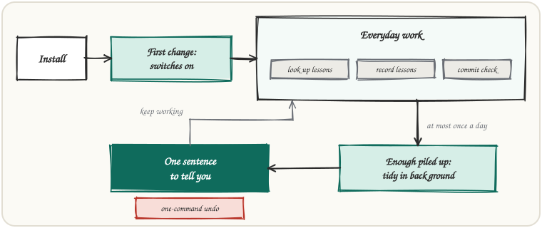
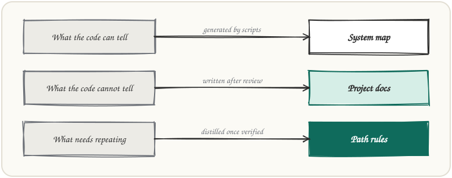
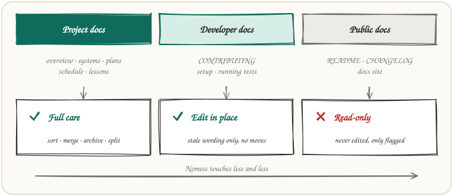
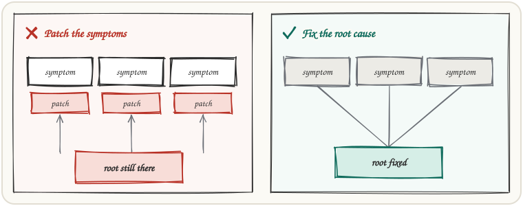

<p align="center"></p>

<h1 align="center">Nomess</h1>

<p align="center"><strong>Long-term agent memory and knowledge management for software development.</strong></p>

<p align="center">
  <a href="https://github.com/penstic123-code/Nomess/actions/workflows/test.yml"></a>
  <a href="https://github.com/penstic123-code/Nomess/releases"></a>
  
  <a href="LICENSE"></a>
</p>

<p align="center">English · <a href="README.zh-CN.md">简体中文</a> · <a href="#install">Quick start</a> · <a href="CHANGELOG.md">Changelog</a></p>

> **AI can write the first version of the code. Will it still understand the project on the 100th change?**

**Nomess is an open-source Claude Code plugin. At its core is long-term project memory, plus code-quality checks and a workflow for multiple agents.**

It helps the AI know how the project is organized, which pitfalls it has hit before, and which conventions must not be broken. It also checks for new problems before each commit, so the code doesn't get messier as features pile up.

It has the core mechanisms of an agent memory system:

- **Memory formation**: extract lessons from development and save them, with aliases, the paths they apply to and their source.
- **Memory consolidation**: Dream tidies, verifies and merges memory and docs in the background.
- **Memory retrieval**: find relevant lessons by path, keyword, alias and module relations.
- **Memory utilization**: load the matching rules by path in later work to guide the agent.
- **Memory updating**: correct stale knowledge; old wording stays in Git history and can be restored.

##  Why a project needs long-term memory

AI is great at the task in front of it. Maintaining the same project over time, things like this happen:

- **Duplicated code**: the feature already exists, and the AI writes it again.
- **The same pitfalls**: a bug fixed last time comes back in a new session.
- **No big picture**: it only edits where the error shows up and breaks another module.
- **Patches pile up**: features seem to work, and the code gets harder to maintain.
- **Agents collide**: each one's change is right on its own; merged, they conflict.

The root of it: **code tells you what the project is now, not why.** Why this needs a lock, why that call must not simply be retried, where last week's bug really came from: all of that lives in some conversation, gone when the session ends, and the next AI starts from scratch.

The idea behind Nomess: **let the AI build up an understanding of the project, make that knowledge take part in the next change, and don't rely on the AI's discipline for anything a program can check.**

##  Install it and forget it

Once installed there is nothing to set up and no commands to remember, and it runs without permission pop-ups:

| Step | Who does it |
| --- | --- |
| **Switching on** | Automatic: the first time the AI changes something in a project |
| **Looking up lessons** | The AI, following its skill, before it starts |
| **Recording lessons** | The AI, following its skill, after fixing a pitfall, with aliases in Chinese and English |
| **Tidying** | Automatic: runs in the background once enough has piled up, at most once a day, then tells you in one sentence with a one-command undo; or just say "tidy up" |
| **Path rules, system map, commit check** | Automatic |



<a name="install"></a>
##  Install

In a terminal:

```bash
claude plugin install nomess --marketplace penstic123-code/Nomess
```

Or inside Claude Code: `/plugin install nomess --marketplace penstic123-code/Nomess`. Installation asks for the Python command: usually `python3` on macOS / Linux, `python` or `py` on Windows.

Then ask Claude Code to build features, fix bugs or refactor as usual. The first time it changes something in a Git project, Nomess creates the config, generates the system map, records existing problems as the baseline and installs the Git commit check, without overwriting existing files or committing, and the AI tells you in one sentence. Don't want it in a project: `nomess off`.

##  Core: long-term project memory

This isn't a "very long memory" that stuffs every chat into the prompt. Nomess keeps project knowledge in layers, each with one job:

| Layer | What it holds | When it's used |
| --- | --- | --- |
| **Claude Code project memory** | Your preferences and personal conventions | Loaded by Claude Code; the tidy moves project facts out of it into the docs |
| **Lessons library** (`docs/lessons/`) | Bug causes, fixes, pitfalls | Looked up by keyword or file before related code changes |
| **Project docs** (`docs/`) | Overview, one page per system, plans, schedule | Read on demand to understand a module |
| **Developer docs / public docs** | `CONTRIBUTING` / `README`, `CHANGELOG` | The first only gets stale wording fixed in place; the second is read-only |
| **Generated system map** | File ownership, module dependencies | Generated from the code by scripts; the AI looks it up when needed |
| **Path rules** (`.claude/rules/nomess/`) | Short constraints distilled from verified lessons | Loaded automatically when a file matching the path is read |

Together they form one loop: **record lessons → tidy and verify → distill into rules → load when related code changes → new lessons keep coming**


### Example: the AI changes the payment module a second time

**The first time**, the AI adds retry logic to a payment call and causes double charges. After the fix, the AI records a lesson by itself (you can also say "remember this" or use `/nomess:lesson`). It goes into the project's Markdown lessons library and is committed with the code.

**Later**, once enough has piled up, Nomess tidies in the background: it merges duplicates, archives outdated entries, checks them against the code, and gives verified entries the paths they apply to and a one-line rule:

```markdown
## Payment retries must reuse the original request's idempotency key
When: adding retries to a payment call; src/payment/, retry, idempotency
Status: verified
Paths: src/payment/**
Rule: Payment retries reuse the original request's idempotency key; never generate a new one
Aliases: retry, resend, 重试, idempotency key, 幂等键
What: A new key makes the gateway treat the retry as a new request and charge twice (a1b2c3d).
```

From that, the script generates a rule file that applies only to the payment folder:

```markdown
---
paths:
  - "src/payment/**"
---
- Payment retries reuse the original request's idempotency key; never generate a new one → docs/lessons/payment.md#Payment retries must reuse the original request's idempotency key
```

Afterwards you get one sentence like "tidied lessons and docs: merged 3, archived 1; undo `git revert …`".

**Next time**, when Claude Code reads files in the payment folder, that short rule enters the context by path. The AI doesn't need to read the whole lessons library, and you don't have to explain the pitfall again.

Looking a lesson up is more than a word match: aliases let "resend" find this entry, and a lookup by file also brings in lessons for the module it belongs to and the modules it directly uses. Lessons learned from a web page or someone else's docs stay unverified and never become rules on their own.


If a constraint can be decided by a program, it can also go into the commit check: even if the AI forgets it, the Git commit blocks it.

##  Where project docs come from

- **What the code can tell**, such as imports and the module list, goes into a system map that scripts generate and keep up to date.
- **What the code can't tell**, such as why a design was chosen or where things break easily, is written into the docs by a developer or the AI after review.
- **What really needs repeating** is distilled into path-scoped rules once verified.



The system map and docs are for the AI to **look up when needed**; they aren't put into every conversation.

##  Docs don't scatter: three tiers

Every project doc has a fixed place: the overview, one page per system, plans, the schedule, the lessons library. When the AI tries to create a doc anywhere else it is stopped on the spot and told where it belongs; the overview ends with a generated index of every doc; pages that grow too long are split into a summary page and sub-pages; docs describe how things are now, and old wording is replaced rather than appended to.

Not every doc is Nomess's to manage. Docs fall into three tiers by who reads them:



##  Quality guardrails: block new problems, don't force you to pay old debt first

Local scripts check for common signs of a messy codebase: duplicated code across files, swallowed exceptions, files or functions that are too long, patch traces like `TODO` / `hack` / `_v2`, dependency cycles and module calls that break project conventions, and in large projects task conflicts and stale references. **Red can block a commit, yellow is for the developer to look at**; what's checked depends on project size and config.

The key is the **baseline**: the project already has 10 problems when you install it, and you don't have to fix them first. Nomess records where things stand and blocks new or worsened serious problems; once old problems are fixed, the baseline tightens so they don't come back.


The commit check runs local Python scripts through a Git hook. **It doesn't call a model and costs 0 tokens.**

##  Understand the code before changing it

Nomess gives Claude Code working guidance: find existing implementations, callers and related lessons first, then decide how to change things. The goal isn't simply fewer lines; it's **solving the problem in the right place instead of patching symptoms**.



##  A workflow sized to the change

Nomess picks one of five workflows by asking "if this change is wrong, what breaks?": edits that don't change behavior, just do it; fixes inside one module, pass the commit check; changes to what one system offers, a few lines of plan first and one code review; changes touching other systems, shared data or stored formats, a written plan reviewed before coding, with irreversible steps backed up or dry-run first and run only after you agree; building or rebuilding a whole system, add a design doc, a small prototype, your sign-off and milestones.


Briefs are only for handing work to another agent; for complex parallel work, give each agent its own Git worktree.

## Commands

Day to day you type nothing. If you want to do things by hand, these are the ones:

| Command | What it does |
| --- | --- |
| `/nomess:lesson "one-line lesson"` | Record a lesson yourself |
| `/nomess:dream` (or just say "tidy up") | Tidy lessons, docs and memory now |
| `/nomess:dream apply 2 5` | Carry out items 2 and 5 of the list waiting for you (`.nomess/dream-notes.md`) |
| `/nomess:review` | Review the current changes |
| `nomess check` / `nomess off` | Run the checks by hand / switch Nomess off in this project |

Commands starting with `nomess` are plugin script commands, available in the shell Claude Code provides; in your own terminal, call `nomess/scripts/nomess.py` from the plugin's install folder.

## FAQ

<details>
<summary><strong>Does it record all my chats?</strong></summary>

No. Chats themselves aren't saved; only lessons worth keeping are: the AI records one after fixing a pitfall, following its skill, or when you ask it to.

</details>

<details>
<summary><strong>How many tokens does it use?</strong></summary>

About **640 tokens** stay in context for a small project; coding tasks add about **2,000 tokens** of `lean-change` guidance. Path rules enter the context only when a matching file is read, and the commit check doesn't call a model. The automatic tidy runs on Sonnet in the background, only when enough has piled up and at most once a day.

</details>

<details>
<summary><strong>What if it records something wrong?</strong></summary>

Lessons are plain Markdown: edit or delete them, or ask the AI to. The automatic tidy checks entries against the code and archives outdated ones; each run is one separate commit you can undo with `git revert`. Entries learned from the web stay unverified and never become rules; anything that would change the project config or loosen a check only goes on a list for you to decide.

</details>

<details>
<summary><strong>Does it upload my code?</strong></summary>

No. The local scripts don't go online and collect no telemetry; project knowledge lives in plain Markdown and JSON files versioned with Git, and the AI reads your code through Claude Code as usual. The automatic tidy only changes lessons, project docs and this project's Claude Code memory folder, never public docs like the README and never the project config. External commands you configure in `nomess.json` run during the matching check, so look at the config before using someone else's repo.

</details>

<details>
<summary><strong>A commit was blocked. What now?</strong></summary>

Read the file location, rule ID and reason in the message, run `nomess check` for the full result, fix it and commit again. Old problems don't block commits just because the plugin was installed. The Git hook is a quality guardrail, not a security sandbox; for team projects, add `nomess check --ci --base <trusted commit>` to CI.

</details>

<details>
<summary><strong>How do I turn it off or uninstall it?</strong></summary>

To switch it off in one project, run `nomess off` in Claude Code's shell: it removes the commit check and stops the automatic setup and tidy there. `/plugin disable nomess` only turns off the plugin's features; **it doesn't remove installed Git hooks**. To uninstall: `claude plugin uninstall nomess`.

</details>

## Research that inspired it

Nomess draws on the two articles below. It is an independent implementation inspired by them, not a reproduction:

- Anthropic, [The components of agent memory](https://www.anthropic.com/engineering/components-of-agent-memory) (2026-11-06): splits agent memory into components and consolidates it offline between sessions. Nomess's layered storage and background tidy draw on this.
- Google Research, [ReasoningBank: Enabling agents to learn from experience](https://research.google/blog/reasoningbank-enabling-agents-to-learn-from-experience/) (2026-04-21): distills reusable strategies from both successful and failed experience, in a loop of retrieval, extraction and consolidation. Nomess's lessons library and its record, look up, tidy loop draw on this.

## Requirements and more

- **Requires**: Claude Code 2.1.277+, Python 3.9+, Git 2.24+; Windows, macOS, Linux.
- **License**: [MIT](LICENSE).
- **Config, script commands and check rules**: [nomess/scripts/README.md](nomess/scripts/README.md)
- **Design notes and skills**: [nomess/skills/](nomess/skills/)
- **Changelog**: [CHANGELOG.md](CHANGELOG.md) · **Issues**: [GitHub Issues](https://github.com/penstic123-code/Nomess/issues)

Nomess is a personally maintained open-source project. Feedback and contributions are welcome.
