<p align="center"></p>

<h1 align="center">nomess</h1>

<p align="center"><b>Keeps a repo clean when several AI agents change it for weeks</b></p>

<p align="center">
  <a href="https://github.com/penstic123-code/Nomess/actions/workflows/test.yml"></a>
  <a href="https://github.com/penstic123-code/Nomess/releases"></a>
  
  
  
  <a href="LICENSE"></a>
</p>

<p align="center">English · <a href="README.zh-CN.md">简体中文</a> · <a href="#install">Install</a> · <a href="#commands">Commands</a> · <a href="CHANGELOG.md">Changelog</a></p>

nomess is a Claude Code plugin.

- **Six parts**: investigate before writing code · a design-first workflow and a commit gate · a system map generated from code · memory and lessons · path-scoped rules · code smell detection
- **What sets it apart**
  - Zero tokens for commit checks: they are Python scripts in Git hooks, no model calls
  - Needs only Python 3.9 and Git
  - Blocks only new problems: existing findings are frozen into a baseline, no cleanup first
  - Everything is Markdown and JSON: lessons, rules and settings are diff-reviewable and follow branches
  - Light on small projects: about 530 tokens always loaded, checks scale with project size

<a name="install"></a>

##  Quick start

```sh
claude plugin install nomess --marketplace penstic123-code/Nomess
```

- One command adds the plugin source and installs (inside Claude Code: `/plugin install nomess --marketplace penstic123-code/Nomess`)
- It asks once for the Python command: `python3` on macOS / Linux, `python` on Windows (`py` if that is all you have); skip with `--config python=python3`, change later in `/config`
- Open Claude Code in your project and run `/nomess:init` (it asks questions, so it needs an interactive session; `claude -p` cannot answer them)
  - Asks the project size, doc language (`en` or `zh-CN`) and main branch
  - Installs the git hooks, freezes today's findings as a baseline, prints a report: existing findings, where the hooks live, a CI snippet
  - Never overwrites a file
- Added to your project:

```
nomess.json            settings and check rules
AGENTS.md              entry with a generated nomess section (CLAUDE.md gets @AGENTS.md as its first line)
docs/overview.md       design overview, for humans
docs/systems/*.md      one page per subsystem (fill in the Details and Pitfalls parts yourself)
docs/lessons/          lessons library
docs/system-map/       generated, do not edit
.nomess-baseline.json  today's findings, so only new ones block
.nomess/               local cache, git-ignored
```

- Large projects also get `docs/schedule.md`, `docs/ownership-map.md` and `docs/plans/`; `.gitignore` gets one line, `.gitattributes` three
- Nothing happens? Run `nomess doctor`: one line per check, with a fix for each problem

## What day-to-day use looks like

```text
nomess: 1 new red finding(s), first src/import.py:42 D1 src/import.py lines 42-58 repeats src/validate.py lines 10-26 (108 tokens, identical); details: nomess check --red
```

- Edit, stage and commit as usual; if an agent copies a long enough block of validation code into another file, the commit stops and the message shows both copies
- The agent reads both locations, makes the import flow call the existing validator, stages and commits again; passing checks are usually silent
- `/nomess:…` commands go into Claude Code, `nomess …` runs the script (in your own terminal: `python <plugin install path>/scripts/nomess.py` with the same arguments)

##  1. Write less code by checking first

- **What it is**: `lean-change`, a skill: instructions Claude Code loads when you add a feature, fix a bug, refactor or choose a dependency
- **What sets it apart**
  - An ordered set of questions, more to work with than "write as little code as possible"
  - Finds the callers and traces the data, so the fix lands in the shared step, not where the error showed up
  - At hand-off the agent reports where it found a solution and how it verified the change
- **Problem it solves**: two upload entry points both store a blank filename as an empty string; patch the one that errored and a third entry point brings the bug back

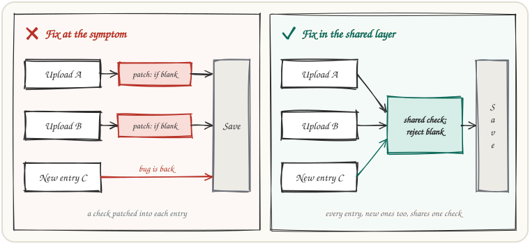

- **How to use it**: describe the task as usual; the agent finds the callers, data, configuration and docs the change touches, reads the files it will edit, and runs `nomess lessons find <path or keyword>` for up to three relevant lessons
- **How it works**: the decision ladder: do we need it? → does the repo already have it? → can the standard library or an installed dependency handle it? → for protocols, concurrency or unfamiliar third-party APIs, consult reliable sources → only then write enough code to solve the problem

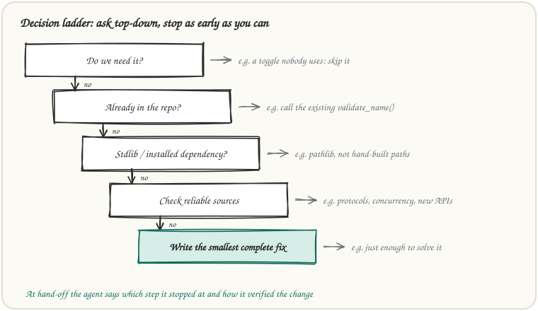

- **Why this design**: moving validation to the shared layer might mean changing two call sites, but both entry points then use the same logic; optimizing for a smaller diff can leave the check in the wrong place

##  2. Workflow and commit gate

- **What it is**: `workflow`, a skill loaded when Claude plans, delegates, reviews or merges; the commit gate is a check script that Git runs
- **What sets it apart**
  - Three tiers: comments and docs go straight in, a self-contained fix uses the light workflow, interfaces / save formats / execution order / data ownership use the full workflow
  - Git runs the gate: it also runs when a person commits from a terminal, with no model calls
  - It checks only what is being committed: stage half a change with `git add -p` and the built-in checks judge that half

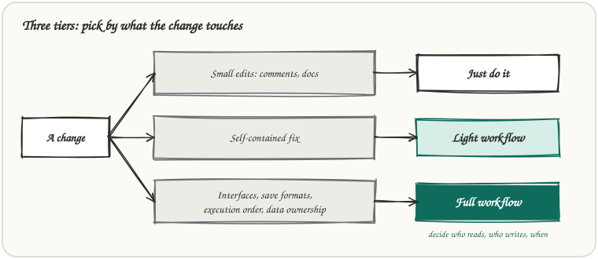

- **Problem it solves**
  - Add a field to a save file: one agent changes the write format, another adds a default when loading; both pass their tests, together they overwrite a value from an older save
  - A call the project forbids shows up in a particular module
- **How to use it**
  - Full workflow: decide who reads, who writes and when, then review the design; before delegating, a subagent that missed the discussion trial-reads the brief; each parallel task gets its own Git worktree
  - Review committed changes by hand: `/nomess:review`
  - Project rules live in `check.rules`: `forbid` for banned patterns, `require` for required ones, `cmd` for a project command's exit code; red blocks, yellow is for people to review
  - A file needs an exception: record the rule, file and reason in the top-level `allow`; new exceptions appear in what reviewers receive

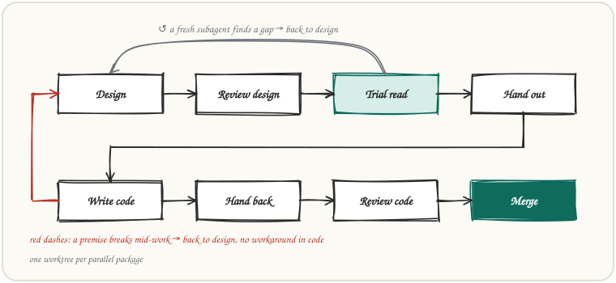

- **How it works**
  - `pre-commit` runs before Git records a regular commit, `pre-merge-commit` before Git creates an automatic merge commit
  - It reads the files, configuration and baseline staged for commit and compares them with the tree at `HEAD`
  - Project `cmd` checks read from disk; if a tracked file has unstaged changes the hook skips the command and tells you to run it in CI

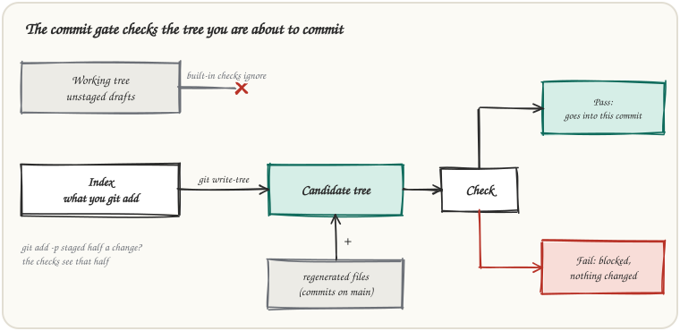

- **Why this design**
  - Checks belong to Git, not to agent discipline; a person can use `git commit --no-verify` in an emergency, and the plugin hook blocks agents from using it or changing `core.hooksPath`
  - CI runs `nomess check --ci --base <可信提交>` as the backstop; deliberately relaxing a rule needs a person's approval, the `nomess-loosen` PR label, and CI passing `--allow-loosen` for that label

##  3. System map and automatically updated docs

- **What it is**: `docs/system-map/index.md`, an entry point generated from code; larger projects also get file, dependency and custom extraction tables
- **What sets it apart**
  - Computed from code, not hand-drawn; refreshed automatically on main-branch commits
  - Hand-written docs can embed generated sections; the script only touches the lines between two markers
- **Problem it solves**: before removing `billing` you want to know who still imports it; a hand-drawn diagram explains why the system is split that way, but six months later it can't tell you who still calls what
- **How to use it**
  - Rebuild by hand: `nomess map`; generated files on feature branches can lag, so run `nomess refresh`
  - Register a generated section (say `events`) in `docgen` and add two markers to the doc; `nomess docgen` replaces only what is between them:

```markdown
<!-- GEN:events BEGIN -->
<!-- GEN:events END -->
```

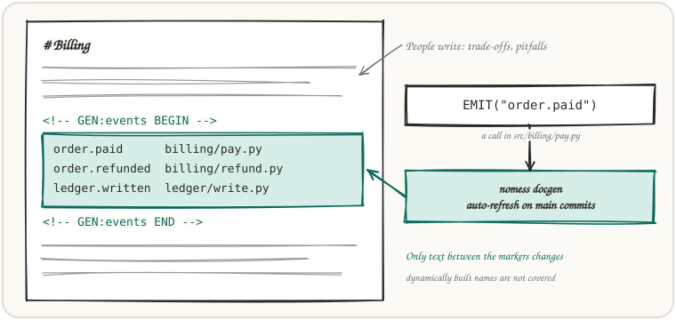

- **How it works**
  - Starts from Git's file list and groups files by the `systems` configuration, or by top-level source directory by default
  - Imports that resolve to repository files become edges, rolled up to subsystem dependencies; Python via the syntax tree, some other languages approximated with text patterns
  - Regexes in `map` extract things that follow a convention, e.g. calls like `EMIT("order.paid")` feed an event table; dynamically built event names fall outside it
  - On eligible main-branch commits the generated changes are added to the proposed commit, checked with it, and staged only if the checks pass; targets with unstaged edits are skipped, `cmd` / `py` generators run on manual refresh, the automatic merge hook only checks

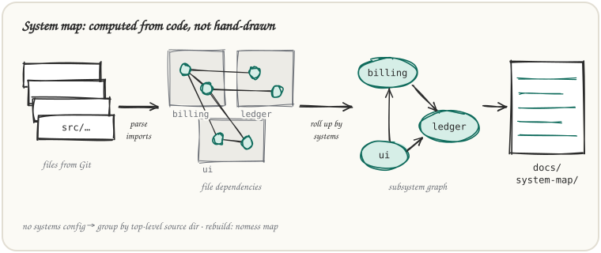

- **Why this design**: people write design trade-offs and pitfalls, the script rebuilds the inventories it can get from code; change an import and the next refresh updates the map

##  4. Memory and lessons

- **What it is**: a lessons library in the repo under `docs/lessons/`, plus `/nomess:lesson` to record and `/nomess:dream` to clean up
- **What sets it apart**
  - Plain Markdown: short, diff-reviewable, follows branches
  - Searched by path and keyword, no vector database
  - Cleanup starts as a proposal and changes nothing until you confirm; the result is committed to Git
- **Problem it solves**: Git shows which lines changed, not why adding retries to checkout requests caused duplicate charges
- **How to use it**
  - Record one: `/nomess:lesson "结算重试必须复用原请求的幂等键"`
  - Put `src/billing/` and "retry" in the entry; it is easier to find than a general note about checkout pitfalls
  - As lessons pile up, run `/nomess:dream` for a proposal, then `/nomess:dream execute`; `execute strike 2 5` drops items 2 and 5

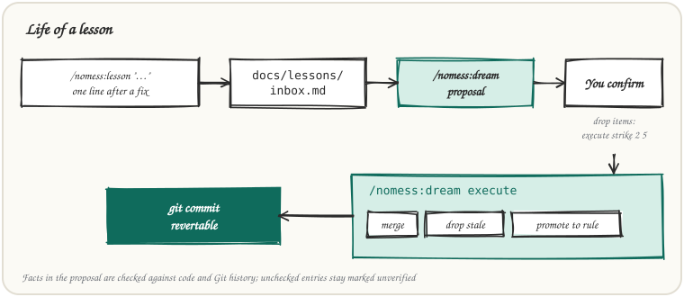

- **How it works**
  - The plugin gives the entry a title, when to look it up, what to do, why, and the evidence; the script dates it and writes it to `inbox.md`; a matching title updates the existing entry, earlier wording stays in Git history
  - Entries not checked against the code are marked unverified
  - `dream` checks the lessons and the current project's Claude Code memory directory for duplicate titles, broken links and pages over budget, then checks the proposal's facts against code and Git history
  - Execution merges duplicates, removes outdated guidance, proposes turning recurring lessons into rules, and verifies the result
- **Why this design**: for "which lesson should I read before changing checkout retries?", a path and a keyword narrow things enough, so there is no vector database to maintain; the trade-off is that a lesson worded differently can slip past

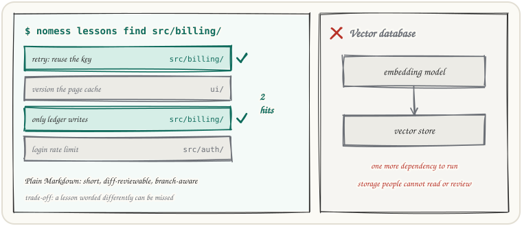

##  5. Path-scoped rules

- **What it is**: rule files under `.claude/rules/nomess/`; the `paths` field in the header tells Claude Code when to load each one
- **What sets it apart**
  - Loaded only when needed: a rule enters context when a matching file is read, at most 400 tokens per file
  - Each rule links to its source entry for the full reasoning
  - Only verified entries are used; drafts in `inbox.md` are skipped
- **Problem it solves**: "reuse the original idempotency key when retrying checkout" matters in `src/billing/`, but an agent changing homepage styles only pays context for it; put every lesson in the main instructions and the general rules get hard to find

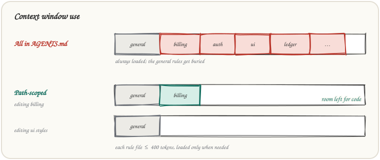

- **How to use it**
  - `dream` proposes promoting a verified, recurring lesson to a path rule, or you write one in the pitfalls section of a subsystem page
  - The source entry needs a verified status, path patterns and a one-sentence rule; run `nomess rules` to generate
- **How it works**
  - Entries with the same set of paths go into one file, named by a hash of those paths
  - A few lines of `grep` output don't count; open the file to bring the rule into context
  - The header looks like this:

```yaml
---
paths:
  - "src/billing/**"
---
```

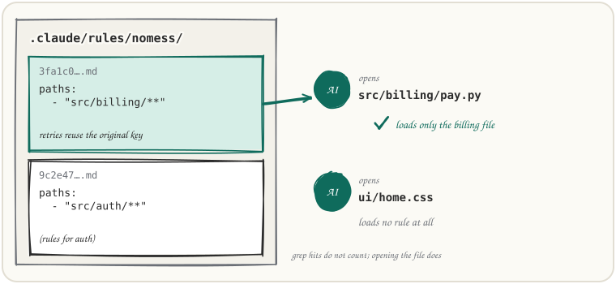

- **Why this design**: path rules carry conventions that need judgment (which request's key to reuse on a retry); a checkable requirement ("only this module may call the low-level write function in billing code") goes into the commit checks, applied the same way every time

##  6. Code smell detection and the ratchet

- **What it is**: built-in checks (duplication, swallowed exceptions, patch traces, length, architecture, scheduling, docs) plus a frozen baseline
- **What sets it apart**
  - Only new or growing problems block; existing ones are frozen
  - The ratchet: once you fix something the allowance is gone, so it can't come back
  - No moving the goalposts: B1 stops hiding findings in the baseline, B2 stops weakening the checks
- **Problem it solves**: an old repo already has three copies of a block; demand they all go and even a small fix has to wait; ignore duplication and a fourth and fifth copy slip in
- **How to use it**
  - Setup runs `nomess check --freeze` to record existing findings in `.nomess-baseline.json`
  - `nomess check --rules` for rule descriptions, `nomess check --all` to see existing findings too
  - After fixing old findings run `nomess check --tighten` to drop resolved entries and lower recorded values

| Check | What the script looks for |
| --- | --- |
| D1 Duplicate code | A long enough run of identical tokens across files is red; a match only after normalization is yellow |
| P1 Swallowed exceptions | Python syntax tree: what a handler catches and does; catching everything and doing nothing (e.g. `pass`) is red, swallowing a specific exception or an empty JS/TS `catch` is yellow |
| P2, P5 Patch traces | Counts markers like `TODO` and `hack`, looks for names like `_v2` and `_old` in files and definitions; yellow |
| S1, S2 Length | Nonblank lines per file, or function start/end lines from Python's syntax tree; new or worsening findings over the limit can be red |
| A1 and `arch` architecture constraints | Imports rolled up into a subsystem graph; a cycle made only of Python import edges is red, one that depends on approximate extraction is yellow; projects can declare forbidden dependency directions or a single owner for writes |
| C4 Parallel scheduling | Two active tasks that will edit the same file, or a task starting before its prerequisite has merged, is red; overlap inferred only from wildcard prefixes is yellow |
| PL-DUP, PL-STALE Documentation | Repeated text across documents, stale paths or subsystem names in unarchived plans; yellow |

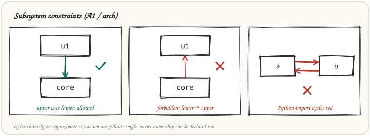

- **How it works**
  - D1: strip whitespace and recognized comments, split into tokens; hash each run of 25 consecutive tokens, take the smallest hash in each window of 26 as a fingerprint; when two files share one, go back to the tokens and extend both ways to measure the real match
  - D1 keeps one pass with tokens as written and one with identifiers and literals normalized by type, so a renamed copy is still found; fingerprints shared by too many files are skipped

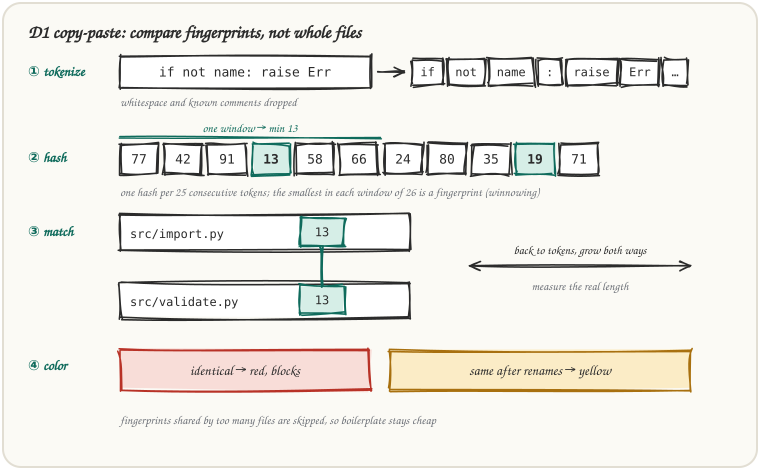

  - The baseline identifies findings by rule ID, original color, path and the finding's own traits; line numbers only appear in messages; a file with two frozen red P1 findings gets a new one only at the third
  - Length metrics are compared with their frozen values; growth beyond the configured tolerance is a regression
  - B1: hand-editing the baseline cannot raise an existing rule's allowance; a first freeze applies only to rules the baseline hasn't enabled, that ran in this check and support freezing, and the records must match the current full scan
  - B2: compares both configurations with defaults filled in; removing checks, raising managed thresholds, lowering the review level, moving the baseline or deleting `nomess.json` all trigger it

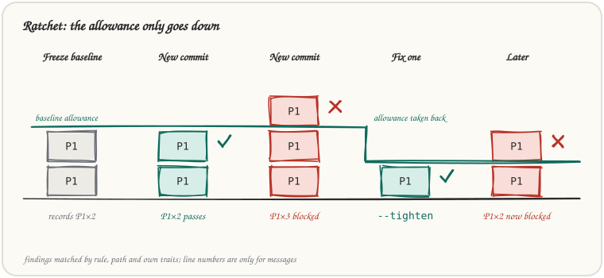

- **Why this design**: freezing keeps adoption cheap; B1 and B2 keep a change from weakening the checks it has to pass

##  How the six parts work together

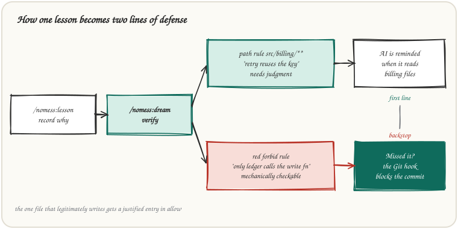

- Checkout and a background recovery job both write to the ledger; after the fix, `/nomess:lesson` records why and which two entry points were involved
- `dream` verifies and keeps the two lessons in different forms:
  - "Reuse the original request's idempotency key on retry" needs judgment → a path rule for billing
  - "Only the ledger module may call the low-level write function" is checkable → a red `forbid` rule, with a justified `allow` for the file that legitimately writes
- Later an agent adds batch recovery: `lean-change` has it find the existing write entry point, the path rule reminds it about the key when it reads the file, the system map shows the billing–ledger dependency
- If batch recovery also changes who owns writes, `workflow` has the coordinator decide that before assigning tasks
- If the agent overlooks all that, the Git hook blocks a staged file in the restricted paths that calls the low-level write function directly

##  Choosing a project size and adjusting the defaults

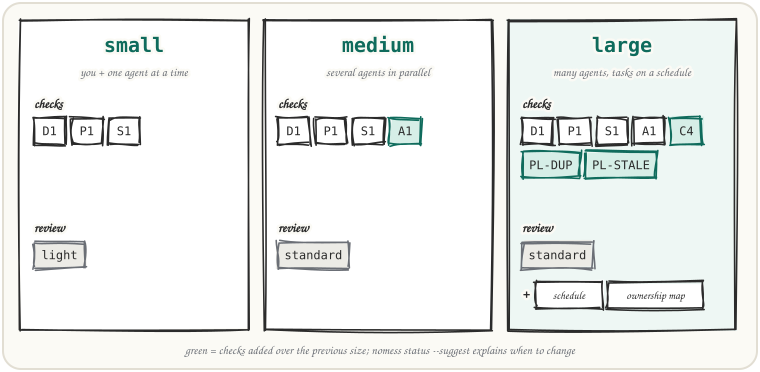

- `size` selects a set of defaults:
  - `small`: you and one agent at a time; D1, P1, S1, `light` review
  - `medium`: several agents in parallel; adds A1, review goes to `standard`
  - `large`: adds C4, PL-DUP, PL-STALE, a schedule for tasks and the files each may edit, and an ownership map for who is responsible for shared data
- This configuration keeps the four `medium` checks, adds a function length check for payment code, and raises review to `strict` for changes that touch it:

```json
{
  "format": "nomess/1",
  "main_branch": "main",
  "size": "medium",
  "lang": "en",
  "check": { "builtin": ["D1", "P1", "S1", "A1"] },
  "scopes": [
    {
      "paths": ["src/payments/**"],
      "why": "payment changes get a full review",
      "checks": { "add": ["S2"] },
      "smells": { "func_lines": 60 },
      "review": "strict"
    }
  ]
}
```

- An explicit `check.builtin` list takes over from the size preset
- `scopes` add or remove individual file checks by path, adjust severity and thresholds, set the review level; when several match, more specific paths override setting by setting; whole-tree checks like A1 and C4 follow top-level settings
- Review levels: `off` turns review off; `light` usually reviews only the combined change and skips docs, configuration and tests; `standard` also reviews logic in individual packages; `strict` reviews every package
- With review on, the full workflow, changes beyond the brief and new exceptions are judged separately for required review; a change touching several directories gets the strictest level; if the project's `AGENTS.md` or `CLAUDE.md` already says how to trial-read, test or review, follow it
- `nomess status --suggest` lists reasons to move up or down (recent merges and file overlap, number of subsystems, lesson backlog, a stretch with one author and no parallel merges); a person decides
- To move up, rerun `/nomess:init` and check any explicit list; if moving down disables checks or lowers review, follow the project's process for approving loosening

## What it doesn't do

- The commit gate enforces working agreements; permissions and protected CI provide the security boundary
- Each new clone needs the local hooks; fast-forward merges, rebases and cherry-picks need coverage beyond them
- The system map extracts inventories; the team writes down the design reasons and trade-offs
- Local scripts have no network access or telemetry, commit checks make no model calls; `dream` and review run in a Claude Code session; custom commands in `nomess.json` run as configured

<a name="commands"></a>

## Using it

| | |
|---|---|
| `/nomess:lesson "<one sentence>"` | record a lesson in `docs/lessons/inbox.md` |
| `/nomess:dream` | proposal: merge duplicates, drop stale entries, turn verified lessons into rules; `/nomess:dream execute` carries it out |
| `/nomess:review` | review the current change at the `review.level` of `nomess.json` |
| `nomess check` / `nomess map` | run the checks / regenerate the system map by hand |

- Your own rules go in `check.rules`: `forbid` reports lines matching a regex, `require` reports files with no match, `cmd` fails on a non-zero exit; `red` blocks, `yellow` only reports
- Regexes are JSON strings, so write `\\b` for `\b`; every key is in [`nomess/scripts/README.md`](nomess/scripts/README.md)

```json
"check": { "rules": [
  {"id": "R1", "level": "red", "what": "no print() in src", "why": "use the logger", "glob": "src/**/*.py", "forbid": "\\bprint\\("}
]}
```

### The `nomess` command in your own terminal

- `nomess` is on the PATH of Claude's shell only
- In your terminal run the script directly: `python <install path>/scripts/nomess.py check`
- `<install path>` is `installPath` in the output of `claude plugin list --json`; `nomess doctor` also prints where things are; everything written as `nomess ...` works that way

### When a commit is blocked

```
nomess: 1 new red finding(s), first src/a.py:1 R1 prevents: use the logger; details: nomess check --red
```

- This is the rule doing its job, not a crash (some tools prefix it with "hook failed")
- Read it as file:line, rule id, what the rule prevents; run `nomess check` for the full list, fix the code, commit again
- Findings frozen at init do not block; only new ones do
- If the rule is wrong for one file, add an entry with a reason to the top-level `allow` list of `nomess.json`; reviewers must look at every new `allow`
- In an emergency a person can skip the check with `git commit --no-verify` (the plugin refuses it when an agent tries)
- Loosening the rules themselves (removing a rule, narrowing a regex, deleting `nomess.json`) also needs `--no-verify` plus the PR label `nomess-loosen`; without the label CI fails

## It is not a security boundary

- The git hooks are a speed bump: `--no-verify` skips them; cherry-pick, rebase and am are not guaranteed to be checked; a clone that never ran init has no hooks
- One working tree does not support several agents committing at once (give parallel agents a worktree each)
- CI is the backstop; add this to `.github/workflows/nomess.yml`:

```yaml
name: nomess
on: [pull_request, push]
jobs:
  check:
    runs-on: ubuntu-latest
    steps:
      - uses: actions/checkout@v4
        with: {fetch-depth: 0}
      - uses: actions/setup-python@v5
        with: {python-version: "3.12"}
      - run: git clone --depth 1 --branch v0.9.2 https://github.com/penstic123-code/Nomess ../nomess-src
      - env:
          BASE: ${{ github.event.pull_request.base.sha || github.event.before }}
          LOOSEN: ${{ contains(github.event.pull_request.labels.*.name, 'nomess-loosen') && '--allow-loosen' || '' }}
        run: python ../nomess-src/nomess/scripts/nomess.py check --ci --base "$BASE" $LOOSEN
```

- `BASE` must be a trusted commit: the PR base, or the push's `before`
- For the first push of a new branch `before` is all zeros; use the merge-base with your main branch instead

## Requirements

- Claude Code 2.1.277 or later, Python 3.9+, git 2.24+
- Sized for small and medium repos: on a repo with thousands of source files the commit check currently takes several seconds (faster caching is planned for 0.9.1)
- `/nomess:init`, `/nomess:lesson`, `/nomess:dream` and agent commits all run scripts through Claude's shell tool, so that tool must work

## Token cost

- **Always loaded: about 530 tokens.** About 280 for the descriptions of two skills and two subagents (check with `claude plugin details nomess`), about 250 for the nomess section (at most 12 lines) in your `AGENTS.md`. Manual commands such as `/nomess:init` cost nothing until you run them.
- **Each context that writes code: about 2,000 more** (the `lean-change` skill text). This is the main cost for a small project. Rule files load only when a matching file is opened, at most 400 tokens each.
- **Hooks: 0.** They are scripts. A blocked commit puts about 60 tokens of output in front of the agent.
- **One `/nomess:dream`:** a normal Claude session, about 95k tokens measured on a 19-page memory folder (proposal about 47k, execution about 49k).

## What it reads and writes

- **In your project**: `nomess.json`, the generated files above, one `.gitignore` line, three `.gitattributes` lines, `.nomess/`
- **Inside `.git/`**: two hook files and a launcher (`.git/nomess-hook`), none of which are versioned
- **Outside the project**
  - The Python option, stored by Claude Code in `~/.claude/settings.json`; the marketplace you add is declared in your user settings
  - After you confirm, `/nomess:dream` edits your Claude Code memory folder, runs `git init` there if needed and commits (never pushes); it reads the `autoMemoryDirectory` setting
  - It does not touch `~/.claude/CLAUDE.md`, does not create `~/.claude/memory/` and does not read other projects
- **Subagents**: `reviewer` and `trial-reader` are read-only by instruction; their tool list includes the shell (they run `nomess` and git to look at the diff), so this is a rule in their prompt, not a sandbox

## Security and privacy

- No network access, no telemetry, no data collection
- **Commands registered in `nomess.json` are executed**: `cmd` check rules and `cmd` / `py` doc generators run on commit and on `nomess check`; `review.cmd` runs on `/nomess:review`
- Treat `nomess.json` like a build script and read it before working in a repo you did not write; `nomess check --no-exec` skips them

## Turn it off, uninstall

- **Pause the Claude Code part:** `/plugin disable nomess`. The git hooks keep running.
- **Stop the commit gate on this machine:** `nomess hooks uninstall` (removes the hook files it wrote and turns the launcher into a no-op; `nomess hooks install` brings it back; delete `.git/nomess-hook` to remove it completely). `nomess hooks status` shows the current state.
- **Stop using nomess in a repo:** commit the deletion of `nomess.json`. That counts as loosening, so it needs the PR label `nomess-loosen`. Files you can then delete: `.nomess-baseline.json`, `docs/system-map/`, `docs/lessons/`, `docs/systems/`, `docs/overview.md` (and the large-project files), `.claude/rules/nomess/`, the nomess section in `AGENTS.md` (between its markers), the `@AGENTS.md` first line of `CLAUDE.md`, the `.nomess/` line in `.gitignore`, the three `.gitattributes` lines, the CI file.
- **Remove the plugin:** `claude plugin uninstall nomess`, then `claude plugin marketplace remove <marketplace name>` (see `claude plugin marketplace list`).

## VS Code extension

- Sidebar for the docs, check results in the Problems panel, stale-doc count in the status bar
- It calls the same script and never calls Claude
- Store release is coming; until then build it from source

## More

[Changelog](CHANGELOG.md) · [License: MIT](LICENSE) · Skill texts: [`nomess/skills/`](nomess/skills/) · Chinese translations: [`docs/zh-CN/`](docs/zh-CN/) · Questions and bugs: GitHub Issues at `penstic123-code/Nomess`. A personally maintained project; no response time is promised.

Credits: ideas from [ponytail](https://github.com/DietrichGebert/ponytail) and Google's [ReasoningBank](https://github.com/google-research/reasoning-bank); no code copied.
