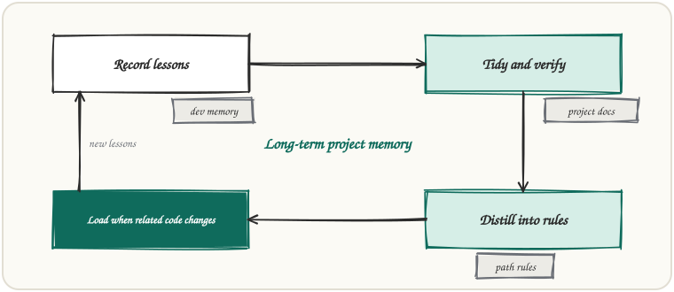
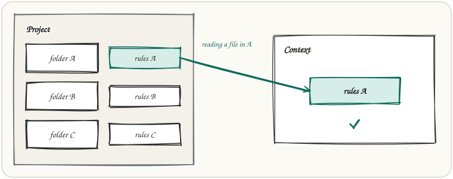
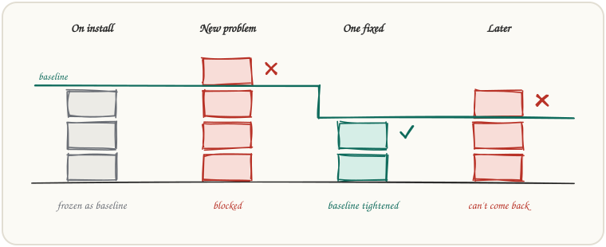

<p align="center"></p>

<h1 align="center">Nomess</h1>

<p align="center"><strong>Claude Code remembers your project, instead of starting from scratch every time and making it messier.</strong></p>

<p align="center">
  <a href="https://github.com/penstic123-code/Nomess/actions/workflows/test.yml"></a>
  <a href="https://github.com/penstic123-code/Nomess/releases"></a>
  
  <a href="LICENSE"></a>
</p>

<p align="center">English · <a href="README.zh-CN.md">简体中文</a> · <a href="#install-and-get-started">Quick start</a> · <a href="CHANGELOG.md">Changelog</a></p>

**Nomess is an open-source Claude Code plugin. At its core is long-term project memory, plus code-quality checks and a workflow for multiple agents.**

It helps the AI know how the project is organized, which pitfalls it has hit before, and which conventions must not be broken. It also checks for new problems before each commit, so the code doesn't get messier as features pile up.

## Why?

AI is great at the task in front of it. Maintaining the same project over time, things like this happen:

- **Duplicated code**: the feature already exists, and the AI writes it again.
- **The same pitfalls**: a bug fixed last time comes back in a new session.
- **No big picture**: it only edits where the error shows up and breaks another module.
- **Patches pile up**: features seem to work, and the code gets harder to maintain.
- **Agents collide**: each one's change is right on its own; merged, they conflict.

The idea behind Nomess: **let the AI build up an understanding of the project, make that knowledge take part in the next change, and don't rely on the AI's discipline for anything a program can check.**

## Core: long-term project memory

This isn't a "very long memory" that stuffs every chat into the prompt. Nomess splits project knowledge into three layers that work together:

| Layer | What it holds | When it's used |
| --- | --- | --- |
| **Dev memory** | Bug causes, fixes, pitfalls | Looked up when a similar problem comes up |
| **Project docs** | Module responsibilities, design trade-offs, dependencies, caveats | Read on demand to understand a module |
| **Path-scoped rules** | Short constraints distilled from verified lessons and docs | Loaded when Claude Code reads a file matching the path |

They aren't three separate tools but one knowledge loop:

**Record lessons → tidy and verify → distill into rules → load when related code changes → new lessons keep coming**



### Example: the AI changes the payment module a second time

**The first time**, the AI adds retry logic to a payment call and causes double charges. After the fix, you record a lesson:

```text
/nomess:lesson "Payment retries must reuse the original request's idempotency key"
```

The lesson goes into the project's Markdown lessons library and is committed and versioned with the code.

**Later**, you run `/nomess:dream` to tidy lessons, find duplicates and outdated entries, and verify them. Once you confirm, verified lessons can become rules for the payment folder.

**Next time**, when Claude Code reads files in the payment module, the matching rule enters the context by path. The AI doesn't need to read the whole lessons library, and you don't have to explain the pitfall again.



If a constraint can be decided by a program, it can also go into the commit check: even if the AI forgets it, the Git commit blocks the violating change.

> **Note:** Nomess doesn't record every conversation. Important lessons need to be recorded; `dream` proposes how to tidy them and applies only after you confirm. Not every old note turns into a path rule automatically.

### Where do project docs come from?

On setup, Nomess generates a system map from the code, including the file ownership and module dependencies it can work out.

- **What the code can tell**, such as imports and part of the module list, is generated and kept up to date by scripts.
- **What the code can't tell**, such as why a design was chosen or where things break easily, is written into the docs by a developer or the AI after review.
- **What really needs repeating** can be distilled into path-scoped rules once verified.


So the system map is mainly for the AI to **look up when needed**; the docs aren't put into every conversation.

## Install and get started

**1. Install the plugin**

In a terminal:

```bash
claude plugin install nomess --marketplace penstic123-code/Nomess
```

Or inside Claude Code:

```text
/plugin install nomess --marketplace penstic123-code/Nomess
```

**2. Set up your project**

Open the project folder, start an interactive Claude Code session, and type:

```text
/nomess:init
```

Choose the project size, documentation language and main branch when asked. Setup creates the config, generates the system map, records existing problems as the baseline, and installs the Git commit check; existing files aren't overwritten.

**3. Keep working**

Ask Claude Code to build features, fix bugs or refactor as usual. Record anything worth remembering with `/nomess:lesson`; run `/nomess:dream` when it's time to tidy.

Installation also asks for the Python command: usually `python3` on macOS / Linux, `python` or `py` on Windows.

## Besides memory

### Quality guardrails: block new problems, don't force you to pay old debt first

Nomess's local scripts check for common signs of a messy codebase, including:

- Duplicated code across files
- Swallowed exceptions
- Files or functions that are too long
- Patch traces like `TODO`, `hack`, `_old`, `_v2`
- Some dependency cycles and module calls that break project conventions
- In large projects, detectable task conflicts, duplicated docs or stale references

Checks have different severities: **red can block a commit, yellow is for the developer to look at**. What's checked depends on project size and config; not every item above is on by default or detected perfectly.

The key is the **baseline**:

> The project already has 10 problems when you install it; you don't have to fix them first. Nomess records where things stand and blocks new or worsened serious problems. Once old problems are fixed, the baseline can be tightened so they don't easily come back.



The commit check runs local Python scripts through a Git hook. **The check itself doesn't call a model and costs 0 tokens.** The AI reading the results and fixing problems still uses tokens.

### Understand the code before changing it

Nomess also gives Claude Code working guidance: find existing implementations, callers and related lessons first, then decide how to change things. The goal isn't simply fewer lines; it's **solving the problem in the right place instead of patching symptoms again and again**.


### A workflow sized to the change

Nomess picks one of five workflows by asking "if this change is wrong, what breaks?":

- Edits that don't change behavior, like comments and docs: just do it.
- Fixes inside one module: change it and pass the commit check; no separate review.
- Changes to what one system offers: a few lines of plan first, then one code review.
- Larger changes touching other systems, shared data or stored formats: on top of that, a written plan, data owners settled, and the plan reviewed before coding; irreversible steps like deleting or migrating data are backed up or dry-run first and run only after you agree.
- Building or rebuilding a whole system: on top of Full, a design doc, a small prototype of the riskiest assumption, your sign-off, then milestones one by one.

Briefs and trial reads are only for handing work to another agent; doing it yourself skips them.


For complex parallel work, give each agent its own Git worktree to avoid conflicts from editing the same working directory.

## Commands

| Command | What it does |
| --- | --- |
| `/nomess:init` | Set up the project, checks and system map |
| `/nomess:lesson "one-line lesson"` | Record a lesson |
| `/nomess:dream` | Propose how to tidy, verify and distill memory into rules |
| `/nomess:dream execute` | Carry out the proposal after you confirm |
| `/nomess:review` | Review the current changes |
| `nomess check` | Run the code checks by hand |
| `nomess refresh` | Update the system map, rule files and generated doc sections |
| `nomess doctor` | Check installation and config problems |

Commands starting with `/nomess:` are **Claude Code session commands**. `nomess check` and the like are **plugin script commands**, available in the shell Claude Code provides; in your own terminal, call `nomess/scripts/nomess.py` from the plugin's install folder.

## FAQ

<details>
<summary><strong>How many tokens does it use?</strong></summary>

About **530 tokens** stay in context for a small project; coding tasks add about **2,000 tokens** of `lean-change` guidance. Path-scoped rules enter the context only when a matching file is read. The Git commit check doesn't call a model.

`/nomess:dream` and AI review use normal model tokens; a large memory tidy-up can be expensive, so run it when needed.

</details>

<details>
<summary><strong>What size of project is it for?</strong></summary>

There are three presets, `small`, `medium` and `large`: a personal project, a few agents in parallel, and projects that need stricter task management. Larger sizes turn on more checks and review by default. It mainly targets small and medium codebases; on large repos the commit check can take a few seconds.

</details>

<details>
<summary><strong>What does it read, upload or change?</strong></summary>

The local scripts don't go online and collect no telemetry. Project knowledge lives in plain Markdown and JSON files and can be versioned with Git.

Setup creates or updates the project config, system map and Git hooks. After you confirm, `/nomess:dream` may also change the Claude Code memory folder linked to the project. External commands you configure in `nomess.json` run during the matching check or generation step, so check the config before using someone else's repo.

</details>

<details>
<summary><strong>A commit was blocked. What now?</strong></summary>

Read the file location, rule ID and reason in the message, run `nomess check` for the full result, fix it and commit again. Old problems normally don't block commits just because the plugin was installed.

The Git hook is a quality guardrail, not a security sandbox, and it can be bypassed. For team projects, add `nomess check --ci --base <trusted commit>` to CI.

</details>

<details>
<summary><strong>How do I turn it off or uninstall it?</strong></summary>

`/plugin disable nomess` in Claude Code only turns off the plugin's features; **it doesn't remove the installed Git hooks**.

To turn off the commit check, run `nomess hooks uninstall` in Claude Code's shell. To uninstall the plugin, run `claude plugin uninstall nomess`. To clean up project files completely, see the config and script docs.

</details>

## Requirements and more

- **Requires**: Claude Code 2.1.277+, Python 3.9+, Git 2.24+.
- **Platforms**: Windows, macOS, Linux.
- **License**: [MIT](LICENSE).
- **Config, script commands and check rules**: [nomess/scripts/README.md](nomess/scripts/README.md)
- **Design notes and skills**: [nomess/skills/](nomess/skills/)
- **Changelog**: [CHANGELOG.md](CHANGELOG.md)
- **Issues**: [GitHub Issues](https://github.com/penstic123-code/Nomess/issues)

Nomess is a personally maintained open-source project. Feedback and contributions are welcome.
