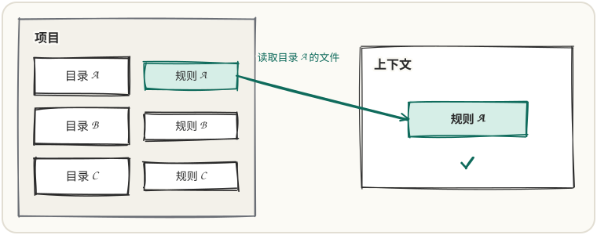
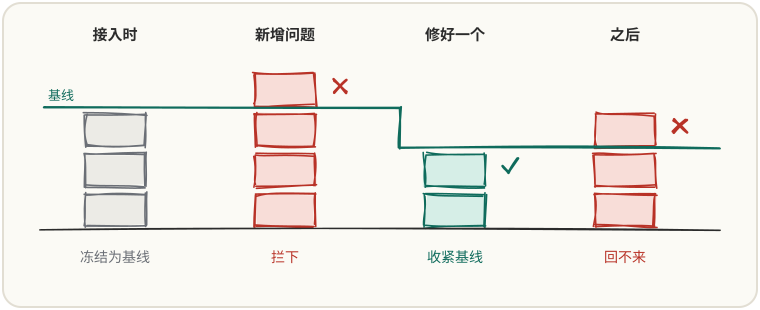
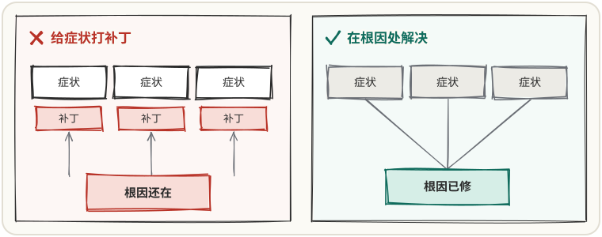
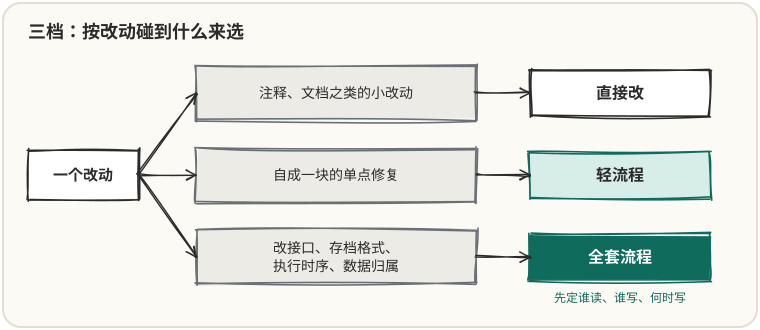

<p align="center"></p>

<h1 align="center">Nomess</h1>

<p align="center"><strong>让 Claude Code 记住你的项目，而不是每次从头摸索、越改越乱。</strong></p>

<p align="center">
  <a href="https://github.com/penstic123-code/Nomess/actions/workflows/test.yml"></a>
  <a href="https://github.com/penstic123-code/Nomess/releases"></a>
  
  <a href="LICENSE"></a>
</p>

<p align="center"><a href="README.md">English</a> · 简体中文 · <a href="#安装和开始使用">快速开始</a> · <a href="CHANGELOG.md">更新记录</a></p>

**Nomess 是一个开源的 Claude Code 插件，核心是项目长期记忆，外加代码质量检查和多 Agent 协作流程。**

它让 AI 更容易知道：这个项目是怎么组织的、以前踩过哪些坑、哪些约定不能破坏。还会在提交代码前检查新问题，尽量避免“功能越做越多，代码越来越乱”。

## 为什么做它？

AI 很擅长完成眼前的任务，但长期维护同一个项目时，容易出现这些情况：

- **重复写代码**：明明已经有相同功能，AI 又实现一遍。
- **反复踩坑**：上次修过的 Bug，换个会话又犯。
- **不了解全局**：只改报错的位置，却破坏其他模块。
- **临时补丁堆积**：功能看似正常，代码越来越难维护。
- **多个 Agent 打架**：分别改得都对，合并后却冲突。

Nomess 的思路是：**先让 AI 积累对项目的理解，再让这些经验真正参与下一次开发；能用程序检查的问题，就不要只靠 AI 自觉。**

## 核心：项目长期记忆

这不是一个把全部聊天记录塞进提示词的“超长记忆”。Nomess 把项目知识分成三层，让它们相互配合：

| 组成 | 存什么 | 什么时候用 |
| --- | --- | --- |
| **开发记忆** | Bug 原因、修复经验、踩过的坑 | 下次遇到相似问题时查阅 |
| **项目文档** | 模块职责、设计取舍、代码依赖、注意事项 | 需要理解某个模块时按需阅读 |
| **按路径加载的规则** | 从已核实经验和项目文档中提炼的简短约束 | Claude Code 读取匹配路径的文件时加载 |

它们不是三个互不相关的工具，而是一条知识积累流程：

**记录经验 → 整理并核实 → 提炼成规则 → 修改相关代码时加载 → 新经验继续积累**


### 举个例子：AI 第二次修改支付模块

**第一次**，AI 给支付接口添加重试逻辑，却造成重复扣款。修复后，你记录一条教训：

```text
/nomess:lesson "支付重试必须复用原请求的幂等键"
```

这条经验会保存到项目的 Markdown 教训库，可以跟代码一起提交和追踪历史。

**之后**，你运行 `/nomess:dream`，让 Nomess 整理经验、检查重复和过期内容，并核实相关信息。你确认整理结果后，已核实的经验可以转成针对支付目录的规则。

**下次**，Claude Code 读取支付模块文件时，相应规则会按路径进入上下文。AI 不需要每次都读完整个教训库，也不必依靠你重新解释这个坑。



如果一条约束能够被程序明确判断，还可以加入提交检查：即使 AI 忘了遵守，Git 提交时也能拦住符合规则的违规改动。

> **注意：** Nomess 不会自动记下每一次对话。重要教训需要记录；`dream` 负责提出整理方案，确认后才应用。路径规则也不是任意历史笔记都会自动变成的。

### 项目文档从哪里来？

初始化时，Nomess 从代码生成系统地图，包括能分析出的文件归属和模块依赖。

- **代码能告诉我们的**，例如导入关系和部分模块清单，由脚本生成、更新。
- **代码不能告诉我们的**，例如为什么采用某个设计、哪里容易出错，需要开发者或 AI 在审查后写进文档。
- **真正需要反复提醒的**，可以在核实后提炼成按路径加载的规则。


因此，系统地图主要供 AI **按需查看**，并不是每次对话都把整套文档放进上下文。

## 安装和开始使用

**1. 安装插件**

在终端运行：

```bash
claude plugin install nomess --marketplace penstic123-code/Nomess
```

也可以在 Claude Code 内输入：

```text
/plugin install nomess --marketplace penstic123-code/Nomess
```

**2. 在项目中初始化**

打开项目目录，进入 Claude Code 交互会话，输入：

```text
/nomess:init
```

按提示选择项目规模、文档语言和主分支。初始化会创建配置、生成系统地图、记录现有代码问题作为基线，并安装 Git 提交检查；已有文件不会被直接覆盖。

**3. 正常开发**

照常让 Claude Code 写功能、修 Bug 或重构。遇到值得记住的经验时用 `/nomess:lesson` 记录；需要整理时运行 `/nomess:dream`。

安装时还会询问 Python 命令：macOS / Linux 通常使用 `python3`，Windows 通常使用 `python` 或 `py`。

## 除了记忆，还做什么？

### 代码质量护栏：只拦新问题，不逼你先还旧债

Nomess 的本地脚本可以检查多种常见的“屎山特征”，包括：

- 跨文件重复代码
- 吞掉异常不处理
- 过长的文件或函数
- `TODO`、`hack`、`_old`、`_v2` 等补丁痕迹
- 部分循环依赖和违反项目约定的模块调用
- 大项目中可识别的任务冲突、文档重复或过时引用

不同检测项有不同的严重程度：**红项可以阻止提交，黄项供开发者检查**。检查范围随项目规模和配置变化，并不是上面的每一项都默认开启或都能完全准确识别。

最重要的是 **基线机制**：

> 接入时项目已有 10 个问题，不必先修完。Nomess 会记录现状，优先拦下之后新增或恶化的严重问题。修好旧问题后，可以收紧基线，不让问题轻易回来。



提交检查通过 Git Hook 调用本地 Python 脚本，**这部分检查本身不调用大模型，消耗 0 Token**。但 AI 读取检查结果并修复问题仍会使用 Token。

### 修改之前先理解代码

Nomess 还会给 Claude Code 提供工作指导：先找已有实现、调用关系和相关经验，再决定如何修改。目标不是一味少写几行，而是**尽量在正确的位置解决问题，避免不断给症状打补丁**。



### 按改动大小走流程

Nomess 按“这个改动错了会坏到哪里”分五档流程：

- 注释、文档等不改行为的修改，直接改。
- 只在一个模块内部的修复，改完过提交检查就行，不单独审。
- 改了某个系统对外的功能，先写几行方案再动手，改完审一次代码。
- 碰到别的系统、共享数据或持久格式的大改动，在此之上再把方案写成文件、定好数据归谁管，动手前先审方案；删除或迁移数据这类不可逆操作，先备份或试跑，你同意后再执行。
- 新建或重做一整个系统，在全套之上再加：设计文档、先用小原型验证风险最大的假设、你签字，然后拆成里程碑逐个完成。

只有交给别的 Agent 做时才写简报、试读；自己做就不用。



复杂并行任务建议让各 Agent 使用独立的 Git worktree，降低同时编辑同一工作区的冲突。

## 常用命令

| 命令 | 作用 |
| --- | --- |
| `/nomess:init` | 初始化项目、配置检查与系统地图 |
| `/nomess:lesson "一句话经验"` | 记录开发教训 |
| `/nomess:dream` | 提出记忆整理、核实和规则提炼方案 |
| `/nomess:dream execute` | 确认方案后执行整理 |
| `/nomess:review` | 审查当前改动 |
| `nomess check` | 手动执行代码检查 |
| `nomess refresh` | 更新系统地图、规则文件和文档里的生成内容 |
| `nomess doctor` | 检查安装和配置问题 |

以 `/nomess:` 开头的是 **Claude Code 会话命令**。`nomess check` 等是**插件脚本命令**，可在 Claude Code 提供的 shell 环境中运行；在你自己的终端里，需要通过插件安装目录中的 `nomess/scripts/nomess.py` 来调用。

## 常见问题

<details>
<summary><strong>会消耗多少 Token？</strong></summary>

小项目的常驻上下文约 **530 Token**；执行写代码任务时，`lean-change` 指导内容约增加 **2,000 Token**。按路径加载的规则只在匹配文件被读取时进入上下文。Git 提交检查不调用模型。

`/nomess:dream` 和 AI 审查则会消耗正常的模型 Token；一次大规模的记忆整理可能很昂贵，建议按需执行。

</details>

<details>
<summary><strong>适合多大的项目？</strong></summary>

有 `small`、`medium`、`large` 三种预设，分别对应个人项目、几个 Agent 并行协作和需要更严格任务管理的项目。规模越大，默认检查和审查越多。当前主要面向中小型代码库，大仓库的提交检查可能需要几秒。

</details>

<details>
<summary><strong>会读取、上传或修改什么？</strong></summary>

本地脚本不联网、没有遥测。项目知识主要保存在普通 Markdown 和 JSON 文件中，可以随 Git 版本控制。

初始化会创建或更新项目配置、系统地图与 Git Hook。`/nomess:dream` 在你确认后还可能修改当前项目关联的 Claude Code 记忆目录。`nomess.json` 中自行配置的外部命令会在对应检查或生成任务中执行，使用别人的仓库前请先检查配置。

</details>

<details>
<summary><strong>提交被阻止了，怎么办？</strong></summary>

先看报错中的文件位置、规则号和原因，再运行 `nomess check` 查看完整结果，修复后重新提交。老问题通常不会因为刚安装插件就阻止提交。

Git Hook 是质量护栏，不是安全沙箱，也可能被人为绕过。团队项目建议在 CI 中配置 `nomess check --ci --base <可信提交>` 进行补充检查。

</details>

<details>
<summary><strong>如何停用或卸载？</strong></summary>

在 Claude Code 中使用 `/plugin disable nomess` 只能停用插件功能，**不会自动关闭已经安装的 Git Hook**。

要关闭提交检查，在 Claude Code 的 shell 中运行 `nomess hooks uninstall`。要卸载插件，运行 `claude plugin uninstall nomess`。如需彻底清理项目文件，参阅配置和脚本说明。

</details>

## 技术要求与更多资料

- **要求**：Claude Code 2.1.277+、Python 3.9+、Git 2.24+。
- **系统**：Windows、macOS、Linux。
- **许可**：[MIT](LICENSE)。
- **详细配置、脚本命令及检查规则**：[nomess/scripts/README.md](nomess/scripts/README.md)
- **原理与本地化技能说明**：[docs/zh-CN/](docs/zh-CN/)
- **版本记录**：[CHANGELOG.md](CHANGELOG.md)
- **反馈问题**：[GitHub Issues](https://github.com/penstic123-code/Nomess/issues)

Nomess 是个人维护的开源项目。欢迎反馈使用中遇到的问题，也欢迎贡献代码。
