<p align="center"></p>

# nomess

[English](README.md) | 简体中文

nomess 是一个 Claude Code 插件，让多个 AI 长期改同一个仓库时代码不乱、少返工。

- **六个部分**：动手前先查的写代码方式 · 先设计后派活的流程和提交闸门 · 从代码生成的系统图 · 记忆与教训 · 按路径加载的规则 · 屎山特征检测
- **特点**
  - 提交检查零 token：是 git 钩子里的 Python 脚本，不调用模型
  - 只依赖 Python 3.9 和 git
  - 只挡新问题：现有问题冻结成基线，不逼你先还旧债
  - 全是 Markdown 和 JSON：教训、规则、配置都能审 diff、跟着分支走
  - 小项目轻：常驻约 530 token，按规模开检查

## 30 秒上手

```sh
claude plugin install nomess --marketplace penstic123-code/Nomess
```

- 一条命令加插件源并安装（Claude Code 里是 `/plugin install nomess --marketplace penstic123-code/Nomess`）
- 安装时问一次 Python 命令：macOS / Linux 用 `python3`，Windows 用 `python`（只有 `py` 就选 `py`）；加 `--config python=python3` 跳过，以后在 `/config` 改
- 在项目里打开 Claude Code，跑 `/nomess:init`（要提问，得在交互会话里跑；`claude -p` 答不了）
  - 问项目规模、文档语言（`en` 或 `zh-CN`）、主分支
  - 装 git 钩子，把现有问题冻结成基线，最后报告：存量问题、钩子位置、一段 CI 配置
  - 从不覆盖已有文件
- 项目里多出：

```
nomess.json            设置和检查规则
AGENTS.md              入口，含生成的 nomess 段（CLAUDE.md 第一行加 @AGENTS.md）
docs/overview.md       设计总览，给人看
docs/systems/*.md      每个子系统一页（"细节"和"坑"两段要你自己补）
docs/lessons/          教训库
docs/system-map/       生成的，别手改
.nomess-baseline.json  现有问题的基线，之后只有新问题才挡
.nomess/               本地缓存，已被 git 忽略
```

- 大项目还多 `docs/schedule.md`、`docs/ownership-map.md`、`docs/plans/`；`.gitignore` 加一行，`.gitattributes` 加三行
- 装了没反应？跑 `nomess doctor`：一项一行，每个问题带修法

## 日常是什么样

```text
nomess: 1 条新红项,首条 src/import.py:42 D1 src/import.py 第 42-58 行和 src/validate.py 第 10-26 行重复(108 个 token,一字不差);详情跑 nomess check --red
```

- 平时照常改代码、暂存、提交；代理把一段够长的校验代码复制到另一个文件，提交就停下，提示指出两处位置
- 代理沿提示读两处代码，让导入流程调用已有校验，再暂存、提交；通过时通常没有输出
- `/nomess:…` 是在 Claude Code 里输入的命令，`nomess …` 是脚本命令（自己终端里用 `python <插件安装路径>/scripts/nomess.py` 加同样参数）

## 1. 少写代码，动手前先查

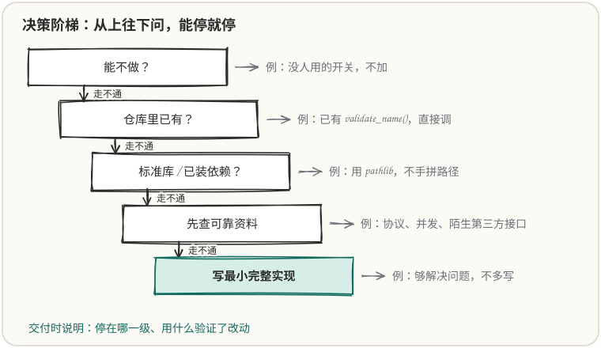

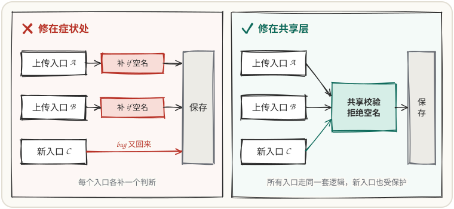

- **是什么**：`lean-change` 是一个 skill，AI 写功能、修 bug、重构、选依赖时自动加载的工作说明
- **特点**
  - 一套有顺序的问题，比一句"尽量少写代码"具体
  - 先找调用者、顺着数据走，修在共享环节而不是报错的那一处
  - 交付时说明停在哪一步、用什么验证
- **解决什么问题**：两个上传入口都把空文件名存成空字符串；只给报错的那个入口补判断，第三个入口一来 bug 又回来
- **怎么用**：照常描述任务；代理先找调用者、数据、配置和文档，读要改的文件，再用 `nomess lessons find <路径或关键词>` 查最多三条相关教训
- **原理**：决策阶梯——有必要做吗？→ 仓库已有吗？→ 标准库或已装依赖能解决吗？→ 协议、并发、陌生第三方接口先查可靠资料 → 前面都不行才写足以解决问题的代码
- **为什么这样设计**：找到共享校验层可能要改两个调用点，但两个入口从此走同一套逻辑；只压缩 diff 反倒容易把判断留在错误的位置

## 2. 防屎山流程和提交闸门


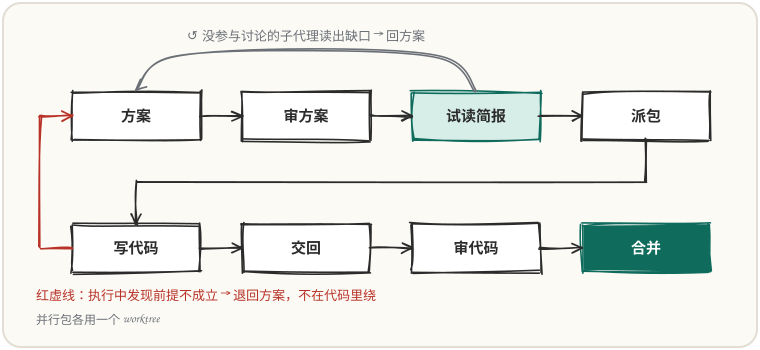

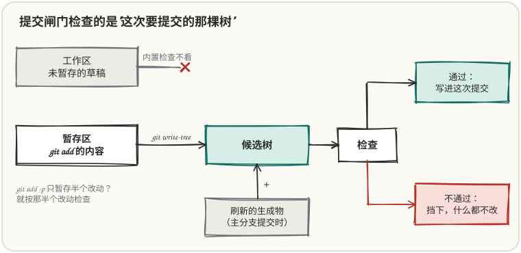

- **是什么**：`workflow` 是规划、派活、审查、合并时加载的 skill；提交闸门是 Git 调用的检查脚本
- **特点**
  - 改动分三档：注释文档直接改，单点修复走轻流程，改接口 / 存档格式 / 执行时序 / 数据归属走全套
  - 闸门交给 Git：人在终端提交也查，不调用模型
  - 只看这次要提交的内容：`git add -p` 只暂存半个改动，内置检查就按那半个判断
- **解决什么问题**
  - 给存档加字段：一个代理改写入格式，另一个给读档补默认值，各自过测试，合起来覆盖旧存档的值
  - 某个模块里出现项目明确禁止的调用
- **怎么用**
  - 全套流程：先定谁读、谁写、什么时候写，再评方案；派活前让没参与讨论的子代理试读简报；并行任务各用一个 Git worktree
  - 手动审查已提交的改动：`/nomess:review`
  - 项目规则写在 `check.rules`：`forbid` 禁止模式，`require` 必须存在的模式，`cmd` 看项目命令退出码；红项挡，黄项供人看
  - 某个文件确需例外：顶层 `allow` 写清规则、文件、理由，新增例外会进审查输入
- **原理**
  - `pre-commit` 在普通提交落盘前跑，`pre-merge-commit` 在 Git 自动建合并提交前跑
  - 读暂存区里将要提交的文件、配置和基线，以 `HEAD` 的树为比较起点
  - 项目登记的 `cmd` 检查读磁盘；已跟踪文件有未暂存改动时钩子跳过它，提示交给 CI
- **为什么这样设计**
  - 检查交给 Git，不靠代理自觉；人应急可用 `git commit --no-verify`，插件钩子拦住代理用它或改 `core.hooksPath` 绕过
  - CI 跑 `nomess check --ci --base <可信提交>` 兜底；有意放宽规则要人批准，PR 打 `nomess-loosen` 标签，CI 据此传 `--allow-loosen`

## 3. 系统图和自动更新的文档

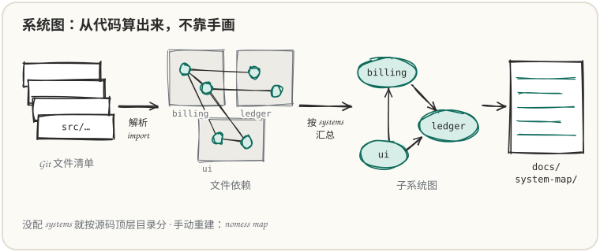

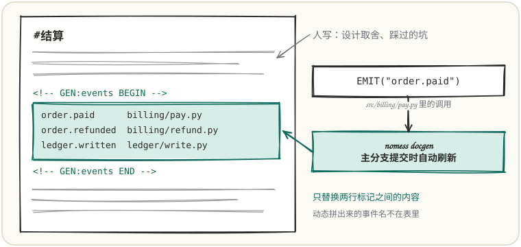

- **是什么**：`docs/system-map/index.md`，从代码生成的系统入口；大项目还有文件表、依赖表、自定义抽取表
- **特点**
  - 从代码算，不靠手画；主分支提交时自动刷新
  - 手写文档里可以嵌生成段，脚本只改两行标记之间
- **解决什么问题**：准备拆掉 `billing` 前想知道谁还在导入它；手写架构图能解释为什么这么分，半年后却很难靠它确认还有谁在调用
- **怎么用**
  - 手动重建：`nomess map`；功能分支上的生成物可能落后，跑 `nomess refresh`
  - 在 `docgen` 登记生成段（比如 `events`），文档里放两行标记，`nomess docgen` 只替换中间：

```markdown
<!-- GEN:events BEGIN -->
<!-- GEN:events END -->
```

- **原理**
  - 从 Git 文件清单出发，按 `systems` 配置分组，没配就按源码顶层目录分
  - 能解析到仓库文件的导入连成边，再汇总到子系统之间；Python 用语法树，部分其他语言用文本模式近似
  - `map` 里的正则可抽取统一约定，如把 `EMIT("order.paid")` 汇成事件表；动态拼出的事件名不在视野内
  - 主分支普通提交时，生成结果先叠到候选提交上一起检查，通过才写进这次提交；带未暂存编辑的目标跳过，`cmd` / `py` 生成器留给手动刷新；自动合并的钩子只检查
- **为什么这样设计**：人写设计取舍和踩过的坑，脚本重算能从代码得到的清单；改了一处导入，不用凭记忆给另一张图补线

## 4. 记忆与教训

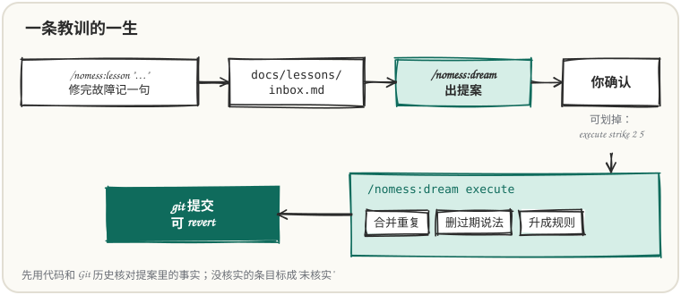

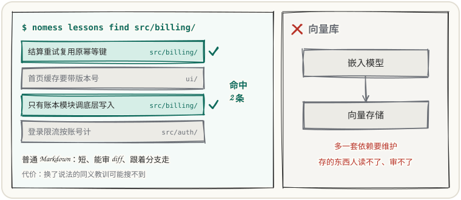

- **是什么**：存在仓库 `docs/lessons/` 里的教训库，加上 `/nomess:lesson` 记录和 `/nomess:dream` 整理两个命令
- **特点**
  - 普通 Markdown：短、能审 diff、跟着分支走
  - 按路径和关键词查，不用向量库
  - 整理先出提案，你确认后才动；执行后留 Git 记录
- **解决什么问题**：Git 能说哪几行改了，却说不清为什么上次给结算请求加重试会重复扣款
- **怎么用**
  - 记一条：`/nomess:lesson "结算重试必须复用原请求的幂等键"`
  - 适用场景里写上 `src/billing/` 和"重试"，比只写"结算有坑"好找
  - 积多了跑 `/nomess:dream` 出提案，看过后 `/nomess:dream execute` 执行；`execute strike 2 5` 划掉第 2、5 项
- **原理**
  - 插件整理出标题、何时该查、怎么做、为什么、依据；脚本加日期写进 `inbox.md`；同标题更新原条目，旧说法在 Git 历史里
  - 没拿代码核实的条目标成未核实
  - `dream` 检查教训库和当前项目的 Claude Code 记忆目录：重复标题、断链、超预算页面，再用代码和 Git 历史核对事实
  - 执行时合并重复、清掉过期说法、提议把反复有用的教训变成规则，执行后校验结果
- **为什么这样设计**：对"改结算重试前查哪条"这种问题，路径加关键词已经能把范围缩得很小，不值得多维护一套向量库；代价是用词不同的同义教训可能搜不到

## 5. 按路径加载的规则

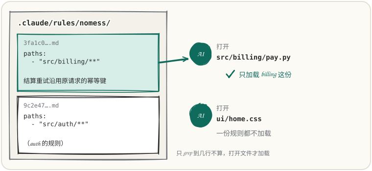

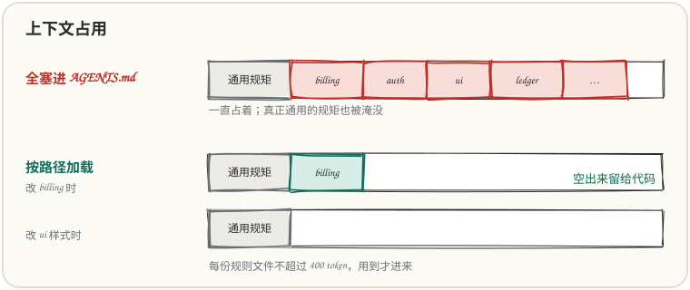

- **是什么**：`.claude/rules/nomess/` 下的规则文件，文件头的 `paths` 告诉 Claude Code 什么时候加载
- **特点**
  - 用到才加载：读取命中路径的文件时才进上下文，每份不超过 400 token
  - 每条规则带源条目链接，短句不够可以回去读完整原因
  - 只收已核实的条目，`inbox.md` 里的草稿不生成
- **解决什么问题**："结算重试沿用原幂等键"对 `src/billing/` 很重要，只改首页样式的代理读到它只是多占上下文；全塞进入口，真正通用的规矩也难找
- **怎么用**
  - `dream` 提议把反复适用、已核实的教训升成路径规则，或者在系统说明页的"坑"里写一条
  - 源条目要有已核实状态、路径模式和一句规则；跑 `nomess rules` 生成
- **原理**
  - 路径集合相同的条目进同一个文件，文件名取这组路径的哈希
  - 只 `grep` 到几行不算，打开文件规则才进上下文
  - 文件头长这样：

```yaml
---
paths:
  - "src/billing/**"
---
```

- **为什么这样设计**：路径规则管要判断的约定（这次重试沿用哪个请求的键）；能判定的限制（结算里只许某模块调底层写入）交给提交检查，每次按同一条件执行

## 6. 屎山特征检测和棘轮

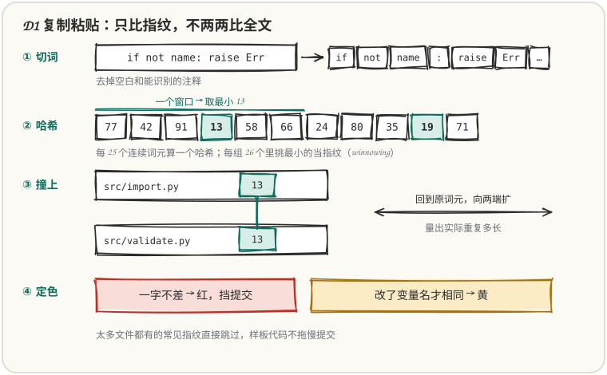

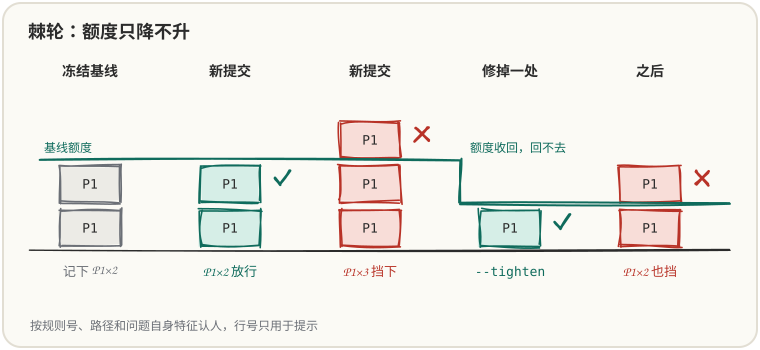

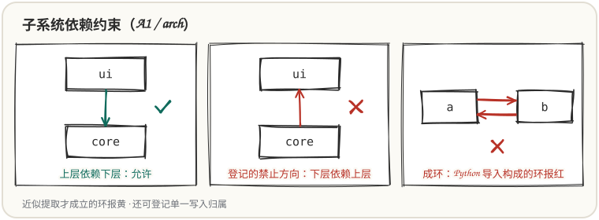

- **是什么**：一组内置检测（重复代码、吞异常、补丁痕迹、长度、架构、排期、文档），加上一份冻结的基线
- **特点**
  - 只挡新问题和长大的问题，存量冻结
  - 棘轮：修好后收回额度，同样的问题回不来
  - 防止"顺手挪防线"：B1 不许把问题藏进基线，B2 不许改尺子
- **解决什么问题**：老仓库已有三段重复代码，一装工具就要求清完，改个小 bug 都得先还旧债；完全放过又让第四、五段悄悄进去
- **怎么用**
  - 初始化时 `nomess check --freeze` 把现有发现写进 `.nomess-baseline.json`
  - `nomess check --rules` 看规则说明，`nomess check --all` 展开存量
  - 修完旧问题跑 `nomess check --tighten`，删掉消失的条目、压低已有数值

| 检测项 | 脚本看什么 |
| --- | --- |
| D1 代码重复 | 跨文件够长一段词元完全相同报红，归一化后才相同报黄 |
| P1 吞异常 | Python 语法树看捕获范围和处理体；捕获全部异常后只写 `pass` 等空操作报红，吞具体异常或 JS/TS 空 `catch` 报黄 |
| P2、P5 补丁痕迹 | 数 `TODO`、`hack` 等标记，找 `_v2`、`_old` 一类文件名或定义名，报黄 |
| S1、S2 长度 | 文件非空行数，或 Python 语法树取函数起止行；越过上限的新增或恶化项可报红 |
| A1 与 `arch` 架构约束 | 导入边汇成子系统图；仅由 Python 导入边构成的环报红，近似提取才成立的环报黄；还可登记禁止的依赖方向、单一写入归属 |
| C4 并行排期 | 两个在做的任务确定改同一文件，或开工时前置任务还没合入，报红；只从通配符前缀推测重叠报黄 |
| PL-DUP、PL-STALE 文档 | 文档间重复的文字、未归档方案里失效的路径或子系统名，报黄 |

- **原理**
  - D1：去掉空白和能识别的注释、切成词元；每 25 个连续词元算一个哈希，每组 26 个哈希里挑最小值当指纹；撞上指纹就回到原词元向两端扩，量出实际重复多长
  - D1 一路保留原词元、一路把标识符和字面量按类型归一，改了变量名的副本也能发现；太多文件都有的常见指纹跳过
  - 基线按规则号、原始颜色、路径和问题自身特征认人，行号只用于提示；某文件冻结了两处 P1 红项，多出第三处才算新的
  - 长度类指标和冻结值比，增长超出容忍幅度才算恶化
  - B1：已有规则的额度不能靠手改文件增加；首次冻结只给基准里还没启用、这次确实执行过且允许冻结的规则，记录要能在本次全量扫描里对上
  - B2：比较两边展开默认值后的配置；删检查、抬高受管阈值、降审查档、换基线位置、删 `nomess.json` 都会触发
- **为什么这样设计**：冻结让接入成本可接受，B1 和 B2 让同一份改动不能顺手把防线挪走

## 六个部分怎么配合

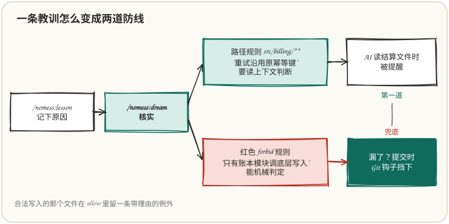

- 结算和后台补偿各写了一次账本；修完故障，用 `/nomess:lesson` 记下原因和两个入口
- `dream` 核对后分两路留下：
  - "重试时沿用原请求的幂等键"要读上下文判断 → 生成到结算目录的路径规则
  - "只有账本模块能调底层写入函数"能判定 → 红色 `forbid` 规则，合法写入的文件留一条有理由的例外
- 后来让 AI 加批量补偿：`lean-change` 让它先找原有写入口，读文件时路径规则提醒保留幂等键，系统图帮它找到结算和账本之间的依赖
- 要改写入归属时，`workflow` 让协调者派活前定下谁写账本
- 代理漏了前面的提醒，暂存的新文件只要在禁止范围内直接调底层写入，Git 钩子就挡住提交

## 适配大小项目和怎么自己调

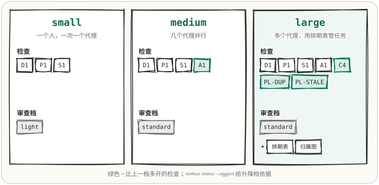

- `size` 给一组缺省值：
  - `small`：一个人、一次一个代理；开 D1、P1、S1，审查 `light`
  - `medium`：几个代理并行；加 A1，审查升到 `standard`
  - `large`：再加 C4、PL-DUP、PL-STALE，用排期表列任务和可改文件，用归属图记录共享数据由谁负责
- 下面这份配置保留中档四项检查，给支付代码加函数长度检查，并把涉及这些文件的审查提到 `strict`：

```json
{
  "format": "nomess/1",
  "main_branch": "main",
  "size": "medium",
  "lang": "zh-CN",
  "check": { "builtin": ["D1", "P1", "S1", "A1"] },
  "scopes": [
    {
      "paths": ["src/payments/**"],
      "why": "支付改动需要逐项审查",
      "checks": { "add": ["S2"] },
      "smells": { "func_lines": 60 },
      "review": "strict"
    }
  ]
}
```

- `check.builtin` 是显式清单，写了就接管规模的默认开关
- `scopes` 按路径加减单项文件检查、调颜色和阈值、改审查档；多个范围命中时更具体的路径逐项覆盖；A1、C4 这类看整棵树的检查由顶层设置控制
- 审查档：`off` 完全关闭；`light` 通常只审合批后的改动，跳过文档、配置、测试；`standard` 还审单包逻辑代码；`strict` 每包都审
- 启用审查时，全套流程、超出简报的改动、新增例外等单独进必审判断；一个改动碰到多个目录取最严的档；项目 `AGENTS.md` 或 `CLAUDE.md` 已规定怎么试读、测试、审查的，按项目的走
- `nomess status --suggest` 列升降档依据（近期合并与文件重叠、子系统数量、积压的教训、一段时间只有一位作者且没有并行合并），由人决定
- 升档重跑 `/nomess:init`，配有显式开关时看一眼清单；降档若关掉检查或降低审查档，走项目批准放宽的流程

## 它不做什么

- 提交闸门是工作约定，安全边界得由权限和受保护的 CI 提供
- 新克隆要接上本地钩子；快进合并、rebase、cherry-pick 不能指望本地钩子兜底
- 系统图提取清单，设计理由和取舍由项目团队写
- 本地脚本不联网、不做遥测，提交检查不调用模型；`dream` 和审查在 Claude Code 会话里做，`nomess.json` 里登记的自定义命令按配置执行

## 日常使用

| | |
|---|---|
| `/nomess:lesson "<一句话>"` | 把教训记进 `docs/lessons/inbox.md` |
| `/nomess:dream` | 出提案：合并重复、删过期、把验证过的教训变成规则；`/nomess:dream execute` 执行 |
| `/nomess:review` | 按 `nomess.json` 的 `review.level` 审当前改动 |
| `nomess check` / `nomess map` | 手动跑检查 / 重新生成系统图 |

- 自己的规则写在 `check.rules`：`forbid` 报匹配正则的行，`require` 报没有匹配的文件，`cmd` 非零退出就报；`red` 挡提交，`yellow` 只报告
- 正则写在 JSON 字符串里，`\b` 要写成 `\\b`；全部键见 [`nomess/scripts/README.md`](nomess/scripts/README.md)

```json
"check": { "rules": [
  {"id": "R1", "level": "red", "what": "no print() in src", "why": "use the logger", "glob": "src/**/*.py", "forbid": "\\bprint\\("}
]}
```

### 在你自己的终端里用 `nomess`

- `nomess` 只在 Claude 的 shell 的 PATH 上
- 自己终端里直接跑脚本：`python <安装路径>/scripts/nomess.py check`
- `<安装路径>` 是 `claude plugin list --json` 输出里的 `installPath`；`nomess doctor` 也会打出各处位置；本文写成 `nomess ...` 的命令都这样跑

### 提交被挡时

```
nomess: 1 new red finding(s), first src/a.py:1 R1 prevents: use the logger; details: nomess check --red
```

- 这是规则在起作用，不是程序崩了（有的工具会在前面加"hook failed"）
- 读法：文件:行、规则号、这条规则防什么；跑 `nomess check` 看完整清单，改代码，再提交
- init 时冻结的存量问题不挡，只有新问题挡
- 规则对某个文件确实不合适：在 `nomess.json` 顶层 `allow` 加一条并写理由；审查必须看每一条新增的 `allow`
- 急用时人可以 `git commit --no-verify` 跳过（代理这么做会被插件拒绝）
- 放宽规则本身（删规则、把正则改窄、删 `nomess.json`）也要 `--no-verify`，并在 PR 上打 `nomess-loosen` 标签；没有标签 CI 会红

## 它不是安全边界

- git 钩子是减速带：`--no-verify` 能跳过；cherry-pick、rebase、am 不保证被检查；没跑过 init 的克隆没有钩子
- 同一个工作区不支持几个代理同时提交（并行的代理各用一个 worktree）
- CI 是兜底，把下面这段放进 `.github/workflows/nomess.yml`：

```yaml
name: nomess
on: [pull_request, push]
jobs:
  check:
    runs-on: ubuntu-latest
    steps:
      - uses: actions/checkout@v4
        with: {fetch-depth: 0}
      - uses: actions/setup-python@v5
        with: {python-version: "3.12"}
      - run: git clone --depth 1 --branch v0.9.2 https://github.com/penstic123-code/Nomess ../nomess-src
      - env:
          BASE: ${{ github.event.pull_request.base.sha || github.event.before }}
          LOOSEN: ${{ contains(github.event.pull_request.labels.*.name, 'nomess-loosen') && '--allow-loosen' || '' }}
        run: python ../nomess-src/nomess/scripts/nomess.py check --ci --base "$BASE" $LOOSEN
```

- `BASE` 必须是可信的提交：PR 的 base，或 push 的 `before`
- 新分支第一次 push 时 `before` 全是 0，改用和主分支的 merge-base

## 要求

- Claude Code 2.1.277 或更新，Python 3.9+，git 2.24+
- 适合中小仓库：源文件上千个的仓库，目前提交时检查要几秒（更快的缓存计划在 0.9.1）
- `/nomess:init`、`/nomess:lesson`、`/nomess:dream` 和代理提交都通过 Claude 的 shell 工具跑脚本，这个工具得能用

## token 开销

- **常驻约 530 token。** 两个 skill 和两个子代理的简介约 280（用 `claude plugin details nomess` 核对），`AGENTS.md` 里的 nomess 段（不超过 12 行）约 250。`/nomess:init` 这类手动命令不运行就不花。
- **每个写代码的上下文多约 2,000**（`lean-change` skill 正文）。这是小项目的主要开销。规则文件只在打开匹配文件时加载，每份不超过 400。
- **钩子：0。** 它们是脚本。被挡一次的提交会在代理面前多约 60 token 的输出。
- **一次 `/nomess:dream`：** 普通的 Claude 会话，在 19 页记忆目录上实测约 9.5 万 token（提案约 4.7 万，执行约 4.9 万）。

## 读写范围

- **项目里**：`nomess.json`、上面列的生成文件、`.gitignore` 一行、`.gitattributes` 三行、`.nomess/`
- **`.git/` 里**：两个钩子文件和一个启动器（`.git/nomess-hook`），都不进版本库
- **项目外**
  - Python 选项，由 Claude Code 存在 `~/.claude/settings.json`；你添加的插件源声明在用户设置里
  - `/nomess:dream` 在你确认后改 Claude Code 的记忆目录，必要时在那里 `git init` 并提交（不推送）；它读 `autoMemoryDirectory` 设置
  - 不碰 `~/.claude/CLAUDE.md`，不建 `~/.claude/memory/`，不读别的项目
- **子代理**：`reviewer` 和 `trial-reader` 是"按指示只读"；工具表含 shell（要跑 `nomess` 和 git 看 diff），所以这是写在提示词里的规矩，不是沙箱

## 安全和隐私

- 不联网，不做遥测，不收集数据
- **`nomess.json` 里登记的命令会被执行**：`cmd` 检查规则和 `cmd` / `py` 文档生成器在提交时和 `nomess check` 时运行；`review.cmd` 在 `/nomess:review` 时运行
- 把 `nomess.json` 当构建脚本对待，在别人写的仓库里干活前先读一遍；`nomess check --no-exec` 跳过它们

## 怎么关掉、卸载

- **只停 Claude Code 里的部分：** `/plugin disable nomess`。git 钩子照跑。
- **本机停用提交闸门：** `nomess hooks uninstall`（删掉它写的钩子文件，启动器变成空操作；`nomess hooks install` 可恢复；要彻底清除再删 `.git/nomess-hook`）。`nomess hooks status` 看当前状态。
- **仓库不再用 nomess：** 提交里删掉 `nomess.json`。这算放宽，要打 PR 标签 `nomess-loosen`。之后可以删的文件：`.nomess-baseline.json`、`docs/system-map/`、`docs/lessons/`、`docs/systems/`、`docs/overview.md`（以及大项目多出的文件）、`.claude/rules/nomess/`、`AGENTS.md` 里的 nomess 段（两个标记之间）、`CLAUDE.md` 第一行的 `@AGENTS.md`、`.gitignore` 里的 `.nomess/` 一行、`.gitattributes` 的三行、CI 文件。
- **卸载插件：** `claude plugin uninstall nomess`，再 `claude plugin marketplace remove <插件源名>`（名字见 `claude plugin marketplace list`）。

## VS Code 扩展

- 侧栏看文档，检查结果显示在问题面板，状态栏显示过时文档数
- 调用同一个脚本，从不调用 Claude
- 商店版即将上架，在那之前可从源码构建

## 更多

[更新记录](CHANGELOG.md) · [许可证：MIT](LICENSE) · skill 原文：[`nomess/skills/`](nomess/skills/) · 中文译文：[`docs/zh-CN/`](docs/zh-CN/) · 问题和 bug：GitHub Issues，仓库 `penstic123-code/Nomess`。个人维护的项目，不承诺响应时间。

致谢：思路来自 [ponytail](https://github.com/DietrichGebert/ponytail) 和 Google 的 [ReasoningBank](https://github.com/google-research/reasoning-bank)；没有拷贝代码。
