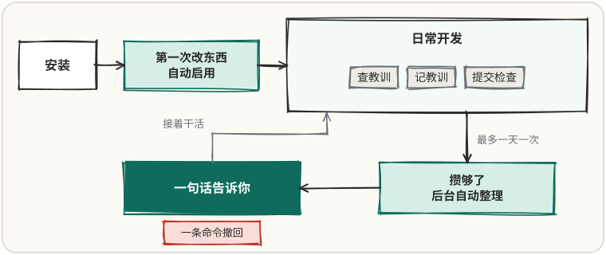
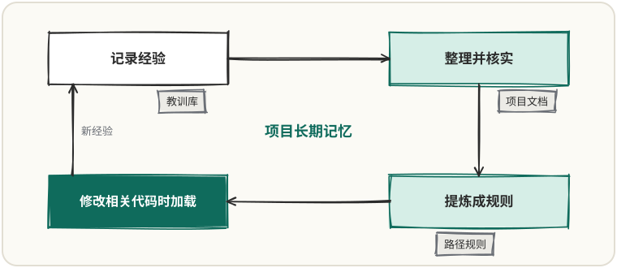
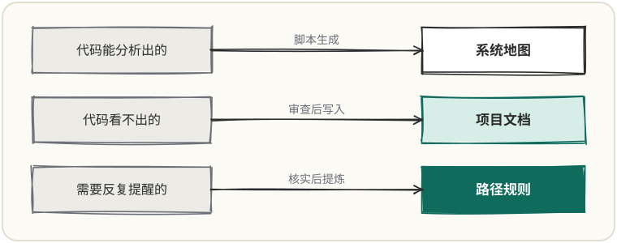
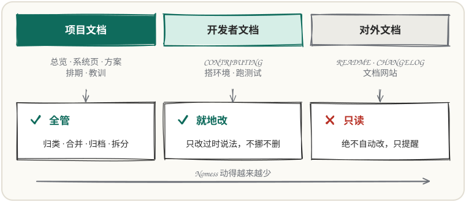

<p align="center"></p>

<h1 align="center">Nomess</h1>

<p align="center"><strong>面向软件开发的长期 Agent 记忆与知识管理系统。</strong></p>

<p align="center">
  <a href="https://github.com/penstic123-code/Nomess/actions/workflows/test.yml"></a>
  <a href="https://github.com/penstic123-code/Nomess/releases"></a>
  
  <a href="LICENSE"></a>
</p>

<p align="center"><a href="README.md">English</a> · 简体中文 · <a href="#install">快速开始</a> · <a href="CHANGELOG.md">更新记录</a></p>

> **AI 能写出第一版代码，但能否在第 100 次修改时仍然理解这个项目？**

**Nomess 是一个开源的 Claude Code 插件，核心是项目长期记忆，外加代码质量检查和多 Agent 协作流程。**

它让 AI 更容易知道：这个项目是怎么组织的、以前踩过哪些坑、哪些约定不能破坏。还会在提交代码前检查新问题，尽量避免“功能越做越多，代码越来越乱”。

它具备 Agent 记忆系统的几个核心机制：

- **记忆写入**（Memory Formation）：从开发经历中提取并保存经验，带上别名、适用路径和出处。
- **记忆巩固**（Memory Consolidation）：Dream 在后台整理、核实、合并记忆和文档。
- **记忆检索**（Memory Retrieval）：按路径、关键词、别名和模块关系查找相关经验。
- **记忆调用**（Memory Utilization）：在后续开发中按路径加载相关规则，指导 Agent 行为。
- **记忆更新**（Memory Updating）：修正过期知识，旧说法留在 Git 历史里，随时可撤回。

##  为什么需要项目长期记忆

AI 很擅长完成眼前的任务，但长期维护同一个项目时，容易出现这些情况：

- **重复写代码**：明明已经有相同功能，AI 又实现一遍。
- **反复踩坑**：上次修过的 Bug，换个会话又犯。
- **不了解全局**：只改报错的位置，却破坏其他模块。
- **临时补丁堆积**：功能看似正常，代码越来越难维护。
- **多个 Agent 打架**：分别改得都对，合并后却冲突。

根子在于：**代码能说明现在是什么样，却不能说明为什么。** 为什么这里要加锁、为什么那个接口不能随便重试、上次那个 Bug 到底怎么来的——这些只存在于某次对话里，会话一结束就没了，下一个 AI 只能从头摸索。

Nomess 的思路是：**先让 AI 积累对项目的理解，再让这些经验真正参与下一次开发；能用程序检查的问题，就不要只靠 AI 自觉。**

##  装完不用管

装好以后不用初始化、不用记命令，全程不弹权限确认：

| 环节 | 谁来做 |
| --- | --- |
| **启用** | 自动：第一次让 AI 在某个项目里改东西时 |
| **查教训** | AI 按技能说明，动手前自己查 |
| **记教训** | AI 按技能说明，踩坑修好后自己记，带中英别名 |
| **整理** | 自动：攒够了在后台跑，最多一天一次，事后一句话告诉你，一条命令撤回；也可以直接说“整理一下” |
| **路径规则、系统地图、提交检查** | 自动 |



<a name="install"></a>
##  安装

在终端运行：

```bash
claude plugin install nomess --marketplace penstic123-code/Nomess
```

也可以在 Claude Code 内输入 `/plugin install nomess --marketplace penstic123-code/Nomess`。安装时会询问 Python 命令：macOS / Linux 通常是 `python3`，Windows 通常是 `python` 或 `py`。

然后照常让 Claude Code 写功能、修 Bug 或重构。第一次在某个 Git 项目里改东西时，Nomess 会创建配置、生成系统地图、把现有代码问题记为基线、装上 Git 提交检查；不覆盖已有文件、不替你提交，AI 会用一句话告诉你。不想在某个项目里用：`nomess off`。

##  核心：项目长期记忆

这不是一个把全部聊天记录塞进提示词的“超长记忆”。Nomess 把项目知识分层存放，各管一件事：

| 层 | 存什么 | 什么时候用 |
| --- | --- | --- |
| **Claude Code 项目记忆** | 你的偏好、个人约定 | Claude Code 自己加载；整理时把里面的项目事实搬进文档 |
| **教训库**（`docs/lessons/`） | Bug 原因、修复经验、踩过的坑 | 改相关代码前按关键词或文件查 |
| **项目文档**（`docs/`） | 总览、每个系统一页、方案、排期 | 理解某个模块时按需读 |
| **开发者文档 / 对外文档** | `CONTRIBUTING` / `README`、`CHANGELOG` | 前者只就地改过时说法，后者只读 |
| **自动系统地图** | 文件归属、模块依赖 | 脚本从代码生成，AI 按需查 |
| **路径规则**（`.claude/rules/nomess/`） | 从已核实教训提炼的简短约束 | 读取匹配路径的文件时自动加载 |

它们串成一条知识积累流程：**记录经验 → 整理并核实 → 提炼成规则 → 修改相关代码时加载 → 新经验继续积累**



### 举个例子：AI 第二次修改支付模块

**第一次**，AI 给支付接口添加重试逻辑，却造成重复扣款。修好后，AI 自己记下一条教训（你也可以说“记一下”或用 `/nomess:lesson`），存进项目的 Markdown 教训库，跟代码一起提交。

**之后**，教训攒够了，Nomess 在后台整理：合并重复、归档过时的、对着代码核实，再给已核实的条目补上适用路径和一句话规则：

```markdown
## 支付重试必须复用原请求的幂等键
概述: 给支付接口加重试时；src/payment/、重试、幂等
状态: 已核实
路径: src/payment/**
规则: 支付重试复用原请求的幂等键，不要重新生成
别名: 重试, retry, 重发, 幂等键, idempotency key
内容: 重新生成幂等键会让网关把重试当成新请求，造成重复扣款（a1b2c3d）。
```

脚本据此生成一个只对支付目录生效的规则文件：

```markdown
---
paths:
  - "src/payment/**"
---
- 支付重试复用原请求的幂等键，不要重新生成 → docs/lessons/payment.md#支付重试必须复用原请求的幂等键
```

事后你收到一句话，比如“整理了教训和文档：合并 3、归档 1；撤回 `git revert …`”。

**下次**，Claude Code 读取支付目录的文件时，这条短规则按路径进入上下文。AI 不用读完整个教训库，你也不用重新解释这个坑。

查教训不只是字面匹配：别名让“重发”也能找到这条；按文件查时还会带出它所属模块、以及它直接依赖的模块的教训。从网页或别人文档里学到的经验一律记为未核实，不会自己变成规则。


如果一条约束能被程序明确判断，还可以加进提交检查：即使 AI 忘了遵守，Git 提交时也会拦住。

##  项目文档从哪里来

- **代码能告诉我们的**，例如导入关系和模块清单，由脚本生成系统地图并自动更新。
- **代码不能告诉我们的**，例如为什么这样设计、哪里容易出错，由开发者或 AI 审查后写进文档。
- **真正需要反复提醒的**，核实后提炼成按路径加载的规则。



系统地图和文档供 AI **按需查看**，不会每次对话都整套放进上下文。

##  文档不散落：三档文档

每类项目文档都有固定位置：总览、每个系统一页、方案、总排期、教训库。AI 想在别处新建文档会被当场拦下，并被告知该放哪；总览末尾有自动生成的全部文档目录；太长的页会拆成概要页加子页；文档只写现在的样子，旧说法直接改掉。

文档类型由项目自己定。第一次启用时 AI 会问一句：用标准的几类；不管位置（适合实验项目：什么都不挡，散放的页只列进“未归类”）；还是在 `nomess.json` 里自己列类型，每一类可以沿用“系统说明页”“方案”这类内置功能。

不是所有文档都归 Nomess 管，按给谁看分三档：



##  代码质量护栏：只拦新问题，不逼你先还旧债

本地脚本检查多种常见的“屎山特征”：跨文件重复代码、吞掉异常、过长的文件或函数、`TODO` / `hack` / `_v2` 等补丁痕迹、循环依赖和违反项目约定的模块调用、大项目中的任务冲突和过时引用。**红项可以阻止提交，黄项供开发者检查**；检查范围随项目规模和配置变化。

最重要的是 **基线机制**：接入时项目已有 10 个问题，不必先修完。Nomess 记下现状，拦下之后新增或恶化的严重问题；修好旧问题后收紧基线，不让它们回来。


提交检查通过 Git Hook 调用本地 Python 脚本，**本身不调用大模型，消耗 0 Token**。

##  修改之前先理解代码

Nomess 给 Claude Code 提供工作指导：先找已有实现、调用关系和相关教训，再决定怎么改。目标不是一味少写几行，而是**在正确的位置解决问题，不给症状打补丁**。


##  按改动大小走流程

Nomess 按“这个改动错了会坏到哪里”分五档：不改行为的直接改；一个模块内部的改完过检查；改了某个系统对外功能的，先写几行方案、改完审一次；碰到别的系统、共享数据或持久格式的，方案写成文件、先审方案，不可逆操作先备份或试跑、你同意再执行；新建或重做整个系统的，再加设计文档、小原型、你签字和里程碑。


只有交给别的 Agent 做时才写简报；复杂并行任务建议各 Agent 用独立的 Git worktree。

## 命令

平时什么都不用敲。想手动的话就这几个：

| 命令 | 作用 |
| --- | --- |
| `/nomess:lesson "一句话经验"` | 自己记一条教训 |
| `/nomess:dream`（或直接说“整理一下”） | 马上整理教训、文档和记忆 |
| `/nomess:dream apply 2 5` | 执行待你决定清单（`.nomess/dream-notes.md`）里的第 2、5 条 |
| `/nomess:review` | 审查当前改动 |
| `nomess check` / `nomess off` | 手动跑检查 / 在当前项目关掉 Nomess |

`nomess` 开头的是插件脚本命令，在 Claude Code 提供的 shell 里可直接用；在你自己的终端里，通过插件安装目录中的 `nomess/scripts/nomess.py` 调用。

## 常见问题

<details>
<summary><strong>会记下我所有的聊天吗？</strong></summary>

不会。聊天记录本身不保存，只记值得留下的教训：AI 踩坑修好后按技能说明记一条，或者你让它记。

</details>

<details>
<summary><strong>会占用多少 Token？</strong></summary>

小项目的常驻上下文约 **640 Token**；写代码时 `lean-change` 指导约增加 **2,000 Token**。路径规则只在匹配文件被读取时进入上下文，提交检查不调用模型。自动整理用 Sonnet 在后台跑，只在攒够了时跑、一天最多一次。

</details>

<details>
<summary><strong>记错了怎么办？</strong></summary>

教训是普通 Markdown，直接改或删就行，也可以让 AI 去改。自动整理会对着代码核实、归档过时的条目；每次整理是一个单独的提交，`git revert` 就能撤回。从网上学来的条目一直是未核实，不会变成规则；要改项目配置或放宽检查的，只列进待你决定的清单。

</details>

<details>
<summary><strong>会上传我的代码吗？</strong></summary>

不会。本地脚本不联网、没有遥测，项目知识存在普通 Markdown 和 JSON 文件里，随 Git 版本控制；AI 读代码照常走 Claude Code 本身。自动整理只改教训、项目文档和本项目的 Claude Code 记忆目录，绝不改 README 这类对外文档和项目配置。`nomess.json` 里自行配置的外部命令会在对应检查中执行，用别人的仓库前请先看一眼配置。

</details>

<details>
<summary><strong>提交被阻止了，怎么办？</strong></summary>

看报错中的文件位置、规则号和原因，运行 `nomess check` 查看完整结果，修复后重新提交。老问题不会因为刚装插件就阻止提交。Git Hook 是质量护栏，不是安全沙箱；团队项目建议在 CI 里加 `nomess check --ci --base <可信提交>`。

</details>

<details>
<summary><strong>怎么停用或卸载？</strong></summary>

在某个项目里关掉：在 Claude Code 的 shell 中运行 `nomess off`，移除提交检查，并停掉那里的自动启用和自动整理。`/plugin disable nomess` 只停用插件功能，**不会移除已装的 Git Hook**。卸载插件：`claude plugin uninstall nomess`。

</details>

## 研究启发

Nomess 的做法受到下面两篇文章启发，是独立实现，不是复现：

- Anthropic，[The components of agent memory](https://www.anthropic.com/engineering/components-of-agent-memory)（2026-11-06）：把 Agent 记忆拆成几个组成部分，并在会话之间离线整理。Nomess 的分层存放和后台整理受此启发。
- Google Research，[ReasoningBank: Enabling agents to learn from experience](https://research.google/blog/reasoningbank-enabling-agents-to-learn-from-experience/)（2026-04-21）：从成功和失败的经验里提炼可复用的策略，在检索、提炼、整合的循环中积累。Nomess 的教训库和“记录、检索、整理”循环受此启发。

## 技术要求与更多资料

- **要求**：Claude Code 2.1.277+、Python 3.9+、Git 2.24+；Windows、macOS、Linux。
- **许可**：[MIT](LICENSE)。
- **详细配置、脚本命令及检查规则**：[nomess/scripts/README.md](nomess/scripts/README.md)
- **原理与本地化技能说明**：[docs/zh-CN/](docs/zh-CN/)
- **版本记录**：[CHANGELOG.md](CHANGELOG.md) · **反馈问题**：[GitHub Issues](https://github.com/penstic123-code/Nomess/issues)

Nomess 是个人维护的开源项目，欢迎反馈问题和贡献代码。
