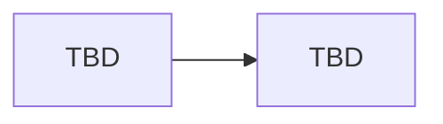

# Design overview

The front page for humans: what this project wants to do, how it does it, and what features it has. Hand-written; no code names (file, function or class names).

## Intent

TBD

## How it works

TBD: a few sentences explaining this diagram.

## Features

- TBD
